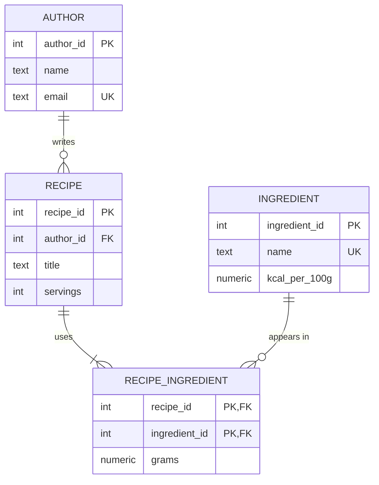

> [!IMPORTANT]
> The content of this file was co-authored with Claude Code. It helped me write this content with given restricted guidelines. 
> Please open a PR or reach out to me if you find any error or missing piece or simply for any type of feedback.

# Databases Module

Module 11 of the Web Programming course (PW 25/27). 19 sessions of 3 hours, 57 hours in total.

You will design, build, secure, optimise and recover the databases of a web application that uses three engines, each for the job it does best:

- **PostgreSQL** (relational) for domain data that must never be lost or contradict itself
- **MongoDB** (documents) for reports that are read often and change shape from case to case
- **Redis** (in-memory key-value) for rankings, counters and temporary reservations that change many times per second

The exercises use the Pagila sample database (a DVD rental shop) so that every student works on the same data. The group project uses all three engines in a different scenario per group.

## Getting started

1. Fork this repository to your own GitHub account and clone your fork.
2. Install Docker Desktop (or Docker Engine with the Compose plugin on Linux).
3. Copy `.env.example` to `.env`. Never commit `.env`.
4. Start the engines:

   ```bash
   docker compose up -d
   ```

5. Check that all three services are `healthy`:

   ```bash
   docker compose ps
   ```

6. Load the Pagila sample database (needed from session 04):

   ```bash
   ./scripts/load-pagila.sh
   ```

From session 04 onwards you will also need Python 3.12+ and [uv](https://docs.astral.sh/uv/). Every Python project in this module declares its dependencies in `pyproject.toml`: `uv add <package>` adds one, `uv sync` installs them into `.venv/`, and `uv run <command>` runs a command inside that environment.

## Example code for each session

`sessions/NN-topic/` holds the session's tutorial written three times, as three independent projects: `fastapi/`, `django/` and `nextjs/` (Next.js with Prisma). Pick the framework you know best, then compare it with the other two. Each project has a README with the steps to run it.

Each project uses its own database so the three never interfere. Create it from the repository root before running the project, as the project's README says:

```bash
./scripts/create-db.sh s04_fastapi --pagila   # a copy of Pagila
./scripts/create-db.sh s02_django             # an empty database
```

The Next.js projects use Prisma for PostgreSQL and the official `mongodb` driver for MongoDB, because Prisma 7 does not support MongoDB.

These projects show the tutorial, not the exercise. Your exercise answers still go in `exercises/`.

## Submitting exercises

- Each exercise goes in `exercises/NN-topic/` in your fork, using the folder name given in each session below.
- Commit and push before the end of the last session day (session 19).
- Challenges are MANDATORY.
- Please be clear when you put your exercise and challlenge files. Ensure that its easy to see which are from the exercise and the ones from the challenge

Each of the 16 exercises (sessions 01 to 16) is marked 0 (not submitted), 1 (incomplete or with relevant errors) or 2 (complete and correct).

## Sessions

- [Session 01: Database engines and diagnosis](#session-01-database-engines-and-diagnosis)
- [Session 02: Modelling, ER diagrams and normalisation](#session-02-modelling-er-diagrams-and-normalisation)
- [Session 03: SQL DDL, data types and constraints](#session-03-sql-ddl-data-types-and-constraints)
- [Session 04: CRUD, upsert and bulk data](#session-04-crud-upsert-and-bulk-data)
- [Session 05: Queries I, joins, aggregation, subqueries and CTEs](#session-05-queries-i-joins-aggregation-subqueries-and-ctes)
- [Session 06: Queries II, window functions and views](#session-06-queries-ii-window-functions-and-views)
- [Session 07: Indexes and optimisation](#session-07-indexes-and-optimisation)
- [Session 08: Transactions and concurrency](#session-08-transactions-and-concurrency)
- [Session 09: Security](#session-09-security)
- [Session 10: Backup and restore](#session-10-backup-and-restore)
- [Session 11: ORM I, SQLAlchemy](#session-11-orm-i-sqlalchemy)
- [Session 12: ORM II, migrations, transactions and API](#session-12-orm-ii-migrations-transactions-and-api)
- [Session 13: MongoDB I, documents, CRUD and validation](#session-13-mongodb-i-documents-crud-and-validation)
- [Session 14: MongoDB II, aggregation pipelines and reports](#session-14-mongodb-ii-aggregation-pipelines-and-reports)
- [Session 15: Redis I, data structures and patterns](#session-15-redis-i-data-structures-and-patterns)
- [Session 16: Redis II, source of truth, rebuild and persistence](#session-16-redis-ii-source-of-truth-rebuild-and-persistence)
- [Session 17: Project integration and disaster day](#session-17-project-integration-and-disaster-day)
- [Session 18: Cross-group review and documentation](#session-18-cross-group-review-and-documentation)
- [Session 19: Delivery and technical discussion](#session-19-delivery-and-technical-discussion)

---

## Session 01: Database engines and diagnosis

### Theory

A JSON file can store data, but it guarantees almost nothing. If two processes write to it at the same time, one write is lost. If the process crashes halfway through a write, the file may be corrupt. Finding one record means reading the whole file. Nothing stops a price from being stored as `"abc"`.

A database engine adds four guarantees on top of storage: persistence (data survives a crash), querying (you ask for what you need without reading everything), integrity (rules the data must follow) and concurrency (many clients read and write safely at once).

Engines differ in how they model data:

- **Relational (PostgreSQL)**: tables with fixed columns, linked by keys. Strong integrity rules and transactions across many tables. Good for orders, payments, bank statements, anything where two records must never contradict each other.
- **Documents (MongoDB)**: JSON-like documents grouped in collections. A document can nest lists and sub-documents, and documents in the same collection can have different shapes. Good for catalogues with variable attributes and for reports read as a whole.
- **Key-value in memory (Redis)**: values (strings, lists, sets, sorted sets, hashes) stored under keys, kept in RAM. Very fast, with built-in expiry. Good for rankings, session data, counters and caches.

Relational engines offer ACID transactions: Atomicity (all or nothing), Consistency (rules hold before and after), Isolation (concurrent transactions do not see each other's half-finished work) and Durability (a committed change survives a crash). Engines that relax these guarantees gain speed or scale, and the application has to deal with what is lost.

A real application often uses more than one engine. When it does, each piece of data needs one **source of truth**: the engine whose copy wins if they disagree. Session 16 covers this in depth.

### Tutorial

Start the module environment and connect to each engine from the command line. Usernames and passwords are in your `.env`.

```bash
docker compose up -d
docker compose ps
```

PostgreSQL:

```bash
docker compose exec postgres psql -U postgres
```

```sql
CREATE TABLE hello (id integer PRIMARY KEY, msg text NOT NULL);
INSERT INTO hello VALUES (1, 'first row');
SELECT * FROM hello;
```

MongoDB:

```bash
docker compose exec mongo mongosh -u root -p --authenticationDatabase admin
```

```js
use sandbox
db.hello.insertOne({ msg: "first document", tags: ["a", "b"] })
db.hello.find()
```

Redis:

```bash
docker compose exec redis redis-cli
```

```
AUTH <password from .env>
SET hello "first key"
GET hello
```

Now stop everything and start it again. The data is still there because each service stores its files in a named Docker volume:

```bash
docker compose down
docker compose up -d
```

`docker compose down -v` deletes the volumes, and the data with them.

To classify a use case, ask: must this data never be lost or contradicted? Is it read as a whole and does its shape vary? Does it change many times per second and can it be rebuilt or expire? Try it on: bank statement, shopping basket, catalogue with variable attributes, recently viewed products, login session, price history, orders, page view counter.

### Exercise (individual)

Folder: `exercises/01-diagnosis/README.md`

1. A screenshot of `docker compose ps` with the three engines healthy.
2. The data model of your database: list of tables and relationships.
3. Three concrete problems in that model (for example duplicated data, a missing constraint, a field that should be a table, a price calculated on read), with the file and line where each one is.
4. What would happen with 100,000 records, or with two users writing at the same time.
5. Would any of the data be better in MongoDB or Redis? Why?

### Challenge

Write a Python script that starts 10 processes, each appending 1,000 records to the same JSON file (read, append, write back). Count how many records end up in the file. Then do the same against a PostgreSQL table with 10 concurrent connections and compare. Explain in a few sentences why the numbers differ.

---

## Session 02: Modelling, ER diagrams and normalisation

### Theory

A data model starts from requirements written in plain language. Nouns usually become **entities** (tables), verbs become **relationships**, and business rules become **constraints**. "A reader borrows copies of a book" gives you `reader`, `copy`, `book` and a `loan` relationship.

An **entity-relationship (ER) diagram** shows entities, their attributes and how they relate. Crow's foot notation marks **cardinality** (how many) and **optionality** (whether the relationship is required):

- 1:1, for example a user and their profile
- 1:N, for example a customer and their orders
- N:N, for example books and authors. A relational database cannot store N:N directly, so you add an **association table** (`book_author`) with a foreign key to each side. If the relationship has its own data (the date a student enrolled in a course), that data lives in the association table.

A UML class diagram shows similar information with a focus on objects and behaviour. Use ER for the database and UML when you are designing application classes.

Every table needs a primary key. A **natural key** comes from the domain (an ISBN, a tax number). A **surrogate key** is an artificial identifier (`id` generated by the database). Surrogate keys are stable when domain values change; keep natural keys as `UNIQUE` constraints.

**Normalisation** removes redundancy so that each fact is stored once:

- **1NF**: every column holds a single value. No lists in a cell, no `phone1`, `phone2`, `phone3`.
- **2NF**: 1NF, and every non-key column depends on the whole primary key, not just part of it (relevant for composite keys).
- **3NF**: 2NF, and no non-key column depends on another non-key column. If `postcode` determines `city`, `city` belongs in another table.

Redundant data causes three anomalies: **insertion** (you cannot record a product until someone orders it), **update** (you change a customer's address in one row and forget the others) and **deletion** (removing the last order deletes the only record of the customer).

**Denormalisation** is sometimes the right call, as long as it is deliberate and written down. There are two usual reasons. Speed: a blog post stores its comment count so the listing page does not count comments for every post, at the cost of updating the count on every new comment. History: a parcel stores the address it was sent to, which must not change when the customer later moves house.

### Tutorial

Take this spreadsheet from a recipe website:

| recipe_id | title | author | author_email | ingredient | kcal_per_100g | grams |
|-----------|-------|--------|--------------|------------|---------------|-------|
| 1 | Pancakes | Ana | ana@example.com | Flour | 364 | 200 |
| 1 | Pancakes | Ana | ana@example.com | Milk | 42 | 300 |
| 2 | Omelette | Rui | rui@example.com | Egg | 155 | 120 |

Problems: Ana's email is stored twice, and so would the calories of flour be in every recipe that uses it (update anomaly); you cannot add an ingredient no recipe uses yet (insertion anomaly); deleting recipe 2 loses Rui (deletion anomaly).

Step by step:

1. Identify entities: author, recipe, ingredient. Recipes and ingredients are N:N, and the relationship has its own data (grams), so it becomes an association table `recipe_ingredient`.
2. Move each fact to the table it depends on: email depends on the author, calories on the ingredient, the title on the recipe, the grams on the recipe-ingredient pair.
3. Decide on denormalisation. The listing page shows calories per serving for every recipe. You could store `kcal_per_serving` on `recipe` so the page does not sum ingredients for each row, and recalculate it whenever the ingredients change. Write the decision down either way.



GitHub renders Mermaid inside Markdown, so the diagram can live in your README and be versioned with the code.

### Exercise (individual)

Folder: `exercises/02-modelling/model.md`

The requirements for a municipal library are in the exercise folder: readers, books, copies, authors, publishers, loans, reservations and fines.

1. An ER diagram in Mermaid, with cardinalities.
2. A list of tables in 3NF, with primary and foreign keys.
3. One denormalisation you would make and why, or why you would make none.

You will implement this model in exercise 03.

### Challenge

The library opens three branches, and copies can be transferred between them. Readers can return a copy at any branch. Extend your model to record where each copy is at any moment and the full history of its transfers. Then find a table in your model that is in 3NF but not in BCNF (Boyce-Codd normal form), or show that none exists, and explain the difference.

---

## Session 03: SQL DDL, data types and constraints

### Theory

DDL (Data Definition Language) is the part of SQL that creates and changes structure: `CREATE TABLE`, `ALTER TABLE`, `DROP TABLE`. A **schema** is a namespace that groups tables; PostgreSQL creates `public` by default.

Choosing data types is part of modelling:

- `integer` for most counts and IDs; `bigint` when a table can pass 2 billion rows.
- `numeric(10,2)` for money. Never `float` or `real`: they cannot store 0.10 exactly, and rounding errors add up.
- `text` for strings. `varchar(n)` only when the limit is a real business rule.
- `timestamptz` for moments in time. It stores UTC and converts on display. Plain `timestamp` has no time zone and causes bugs when servers or users are in different zones.
- `boolean`, `date`, `uuid` where they fit.
- An enum type or a reference table for a fixed list of values. A reference table is easier to change and can hold extra data (a label, an order).
- `jsonb` for data whose shape really varies and is not queried relationally. It is not a way to skip modelling.

Use **identity columns** for surrogate keys: `integer GENERATED ALWAYS AS IDENTITY`.

**Constraints** are domain rules enforced by the database, whatever application writes to it:

- `PRIMARY KEY`: unique and not null.
- `FOREIGN KEY`: the referenced row must exist.
- `UNIQUE`: no duplicates, including across several columns (`UNIQUE (author_id, title)`: one author cannot publish two recipes with the same title).
- `CHECK`: a condition each row must meet (`CHECK (quantity > 0)`).
- `NOT NULL` and `DEFAULT`.

Each foreign key needs an `ON DELETE` behaviour chosen from the domain:

- `RESTRICT` (or the default `NO ACTION`): refuse to delete a parent that has children. Use it when deleting would lose history (an author with published recipes).
- `CASCADE`: delete the children too. Use it when the children have no meaning without the parent (the ingredient list of a recipe).
- `SET NULL`: keep the child and clear the link. Use it when the relationship is optional (a task assigned to an employee who leaves).

Keep the schema in numbered scripts (`001_create_tables.sql`, `002_add_indexes.sql`) so that anyone can rebuild it in order. In session 12 these become Alembic migrations.

### Tutorial

Implement the recipe model from session 02:

```sql
CREATE TABLE author (
    author_id  integer GENERATED ALWAYS AS IDENTITY PRIMARY KEY,
    name       text NOT NULL,
    email      text NOT NULL UNIQUE,
    created_at timestamptz NOT NULL DEFAULT now()
);

CREATE TABLE ingredient (
    ingredient_id integer GENERATED ALWAYS AS IDENTITY PRIMARY KEY,
    name          text NOT NULL UNIQUE,
    kcal_per_100g numeric(6,1) NOT NULL CHECK (kcal_per_100g >= 0)
);

CREATE TABLE recipe (
    recipe_id    integer GENERATED ALWAYS AS IDENTITY PRIMARY KEY,
    -- RESTRICT: an author with published recipes cannot be deleted by accident
    author_id    integer NOT NULL REFERENCES author ON DELETE RESTRICT,
    title        text NOT NULL,
    servings     integer NOT NULL CHECK (servings BETWEEN 1 AND 50),
    published_at timestamptz,
    UNIQUE (author_id, title)
);

CREATE TABLE recipe_ingredient (
    -- CASCADE: the ingredient list means nothing without its recipe
    recipe_id     integer NOT NULL REFERENCES recipe ON DELETE CASCADE,
    ingredient_id integer NOT NULL REFERENCES ingredient ON DELETE RESTRICT,
    grams         numeric(7,1) NOT NULL CHECK (grams > 0),
    PRIMARY KEY (recipe_id, ingredient_id)
);
```

Now try to break the rules and read the error each time:

```sql
INSERT INTO ingredient (name, kcal_per_100g) VALUES ('Sugar', -1);
-- ERROR: new row for relation "ingredient" violates check constraint "ingredient_kcal_per_100g_check"

INSERT INTO recipe (author_id, title, servings) VALUES (999, 'Soup', 4);
-- ERROR: insert or update on table "recipe" violates foreign key constraint "recipe_author_id_fkey"

INSERT INTO author (name, email) VALUES ('Ana', 'ana@example.com'), ('Ana 2', 'ana@example.com');
-- ERROR: duplicate key value violates unique constraint "author_email_key"
```

Name your constraints (`CONSTRAINT kcal_not_negative CHECK (kcal_per_100g >= 0)`) when you want clearer error messages in the application.

Save the script as `001_create_tables.sql` and run it on an empty database:

```bash
docker compose exec -T postgres createdb -U postgres recipes
docker compose exec -T postgres psql -U postgres -d recipes -v ON_ERROR_STOP=1 < 001_create_tables.sql
```

### Exercise (individual)

Folder: `exercises/03-ddl/`

1. `schema.sql`, runnable on an empty PostgreSQL database, implementing your library model from exercise 02. Include at least one `CHECK`, one composite `UNIQUE`, and one foreign key whose `ON DELETE` is justified in a comment.
2. `invalid.sql` with 5 `INSERT` statements that must fail, each with a comment naming the constraint that rejects it.

### Challenge

Make the database reject invalid ISBNs. Create a `DOMAIN isbn13` over `text` whose `CHECK` validates both the format (13 digits, optional hyphens) and the check digit, using an `IMMUTABLE` SQL function. Use the domain in your `book` table. Prove that a valid ISBN is accepted, and that one with a wrong check digit is rejected. Explain why the function should be `IMMUTABLE`.

---

## Session 04: CRUD, upsert and bulk data

### Theory

CRUD covers the four basic operations: Create (`INSERT`), Read (`SELECT`), Update (`UPDATE`) and Delete (`DELETE`).

`SELECT` filters with `WHERE` using `=`, `<>`, `<`, `>`, `LIKE` (case-sensitive pattern), `ILIKE` (case-insensitive), `IN (...)`, `BETWEEN` and `IS NULL`. Note that `= NULL` never matches anything; use `IS NULL`. `ORDER BY` sorts, `DISTINCT` removes duplicates, and `LIMIT`/`OFFSET` paginate.

`UPDATE` and `DELETE` without a correct `WHERE` change every row in the table. Two habits prevent this: run a `SELECT` with the same `WHERE` first and check the row count, and run the change inside a transaction so you can `ROLLBACK` if the count is wrong.

`RETURNING` makes `INSERT`, `UPDATE` and `DELETE` return the affected rows, which saves a second query to find a generated ID.

An **upsert** inserts a row, or updates it if it already exists, in one atomic statement: `INSERT ... ON CONFLICT (key) DO UPDATE` or `DO NOTHING`. It needs a `UNIQUE` or primary key constraint on the conflict columns.

Testing with ten rows hides problems that appear with a million. Generate test data in volume, and make it **reproducible** with a fixed random seed so that everyone gets the same data and results can be compared. For large loads, `COPY` is much faster than individual `INSERT` statements because it streams rows in one command.

### Tutorial

Load Pagila (the script is in this repository):

```bash
./scripts/load-pagila.sh
docker compose exec postgres psql -U postgres -d pagila
```

Read:

```sql
SELECT title, length, rating
FROM film
WHERE rating = 'R' AND title ILIKE '%love%'
ORDER BY length DESC
LIMIT 10;
```

Insert and get the generated key back:

```sql
INSERT INTO actor (first_name, last_name)
VALUES ('ADA', 'LOVELACE')
RETURNING actor_id, last_update;
```

Safe update:

```sql
BEGIN;
SELECT count(*) FROM film WHERE rating = 'NC-17' AND rental_rate < 1;  -- expect N rows
UPDATE film SET rental_rate = 1.99
WHERE rating = 'NC-17' AND rental_rate < 1
RETURNING film_id, title, rental_rate;
-- the count matches N? COMMIT. Otherwise ROLLBACK.
COMMIT;
```

Upsert into a table with a primary key:

```sql
CREATE TABLE film_views (
    film_id integer PRIMARY KEY REFERENCES film,
    views   integer NOT NULL DEFAULT 0
);

INSERT INTO film_views (film_id, views) VALUES (1, 1)
ON CONFLICT (film_id) DO UPDATE SET views = film_views.views + 1
RETURNING *;
```

Run the upsert twice and watch `views` go from 1 to 2.

Bulk data in SQL, reproducible with `setseed`:

```sql
SELECT setseed(0.42);

CREATE TABLE reading AS
SELECT g AS reading_id,
       now() - random() * interval '365 days' AS taken_at,
       round((random() * 100)::numeric, 2)    AS value
FROM generate_series(1, 1000000) AS g;
```

Bulk data in Python with Faker and `COPY` (in a uv project: `uv add faker "psycopg[binary]"`, then `uv run python seed.py`):

```python
import os
import psycopg
from faker import Faker

Faker.seed(42)
fake = Faker("en_GB")

with psycopg.connect(os.environ["DATABASE_URL"]) as conn:
    with conn.cursor().copy("COPY person (name, email, city) FROM STDIN") as copy:
        for _ in range(500_000):
            copy.write_row((fake.name(), fake.unique.email(), fake.city()))
```

Time the same load with one `INSERT` per row to see the difference.

### Exercise (individual)

Folder: `exercises/04-crud/queries.sql`

12 operations on Pagila, with the expected result (row count or value) given in the brief. Examples: films rated `PG-13` and longer than 120 minutes sorted by title; customers with no rentals in the last year; update the rental rate of one category using `RETURNING`; upsert an actor; delete test payments after checking the `WHERE` first.

### Challenge

Write a Python seed script that adds 1 million rentals to Pagila in under 30 seconds, using `COPY`. Every row must be valid: existing inventory, customer and staff IDs, and a return date after the rental date. Run it twice on fresh copies of Pagila and prove the data is identical both times (for example, compare `md5(string_agg(...))` over the table ordered by primary key). Make the script idempotent: running it again on a database that already has the data must not create duplicates.

---

## Session 05: Queries I, joins, aggregation, subqueries and CTEs

### Theory

A **join** combines rows from two tables where a condition holds.

- `INNER JOIN` keeps only rows with a match on both sides.
- `LEFT JOIN` keeps every row from the left table; columns from the right are `NULL` where there is no match.
- A **self join** joins a table to itself, for example to find pairs of rows that share something.

Joining along a 1:N relationship repeats the "1" side once per match. If you then `SUM` a column from the "1" side, you count it several times. Aggregate before joining, or check row counts as you add each join.

An **anti-join** finds rows with no match: `LEFT JOIN ... WHERE right.id IS NULL`, or `WHERE NOT EXISTS (...)`. `NOT EXISTS` is usually clearer. Avoid `NOT IN (subquery)` when the subquery can return `NULL`: it then returns no rows at all.

**Aggregation** collapses groups of rows into one: `COUNT`, `SUM`, `AVG`, `MIN`, `MAX` with `GROUP BY`. `WHERE` filters rows before grouping; `HAVING` filters groups after. `COUNT(*)` counts rows; `COUNT(column)` counts non-null values in that column, which matters after a `LEFT JOIN`.

A **subquery** is a query inside another one: in `WHERE` (`price > (SELECT avg(price) FROM product)`), in `FROM` as a derived table, or **correlated**, referring to the outer row and evaluated per row. `EXISTS` checks whether a subquery returns any row.

A **CTE** (`WITH name AS (...)`) names an intermediate result so you can build a complex query in readable steps. Since PostgreSQL 12, simple CTEs are inlined, so they cost nothing extra.

The method for a business question: write down what one result row is (a customer? a month per category?), find the tables that hold the data, join them one at a time while checking row counts, then aggregate and filter.

### Tutorial

"How many rentals has each staff member handled, per store?"

```sql
SELECT s.store_id, st.first_name, st.last_name, count(*) AS rentals
FROM rental r
JOIN staff st ON st.staff_id = r.staff_id
JOIN store s  ON s.store_id  = st.store_id
GROUP BY s.store_id, st.staff_id
ORDER BY s.store_id, rentals DESC;
```

"Which customers rented more than 40 films?" (`HAVING`)

```sql
SELECT c.customer_id, c.first_name, c.last_name, count(*) AS rentals
FROM customer c
JOIN rental r ON r.customer_id = c.customer_id
GROUP BY c.customer_id
HAVING count(*) > 40
ORDER BY rentals DESC;
```

"How many rentals has each customer made, including customers with none?" (`LEFT JOIN`, `COUNT(*)` vs `COUNT(column)`)

```sql
SELECT c.customer_id, c.first_name, c.last_name,
       count(r.rental_id) AS rentals,
       count(*)           AS joined_rows
FROM customer c
LEFT JOIN rental r ON r.customer_id = c.customer_id
GROUP BY c.customer_id
ORDER BY rentals, c.customer_id;
```

999 rows, one per customer. Customers 647 and 978 have no rentals. The `LEFT JOIN` gives each of them one row with `NULL` in every `rental` column, so `count(r.rental_id)` is 0 and `count(*)` is 1. With `JOIN` instead of `LEFT JOIN` those two customers disappear and you get 997 rows.

"Which films have no copy in any store?" (anti-join)

```sql
SELECT f.film_id, f.title
FROM film f
WHERE NOT EXISTS (
    SELECT 1 FROM inventory i WHERE i.film_id = f.film_id
);
```

"Which customers have never rented a film?" (the same anti-join written with `LEFT JOIN ... IS NULL`)

```sql
SELECT c.customer_id, c.first_name, c.last_name
FROM customer c
LEFT JOIN rental r ON r.customer_id = c.customer_id
WHERE r.rental_id IS NULL
ORDER BY c.customer_id;
```

Two rows, customers 647 and 978. Test `IS NULL` on a column of the right table that can never be `NULL` in a real row, such as its primary key. Otherwise a row that exists but has a `NULL` in that column looks like a missing match.

"Which customers share their first and last name with another customer?" (self join, to look for duplicate accounts)

```sql
SELECT c1.customer_id, c2.customer_id AS other_customer_id, c1.first_name, c1.last_name
FROM customer c1
JOIN customer c2
  ON  c2.first_name  = c1.first_name
  AND c2.last_name   = c1.last_name
  AND c2.customer_id > c1.customer_id
ORDER BY c1.last_name, c1.first_name, c1.customer_id, other_customer_id;
```

The same table appears twice under two aliases. 20 pairs. `c2.customer_id > c1.customer_id` leaves out each customer paired with itself and lists each pair once: with `<>` you get 40 rows, and with no condition on the id 1,039. A name shared by three customers, such as JAMES BROWN, gives three pairs.

"Which films are longer than the average film?" (subquery in `WHERE`)

```sql
SELECT f.film_id, f.title, f.length
FROM film f
WHERE f.length > (SELECT avg(length) FROM film)
ORDER BY f.length DESC, f.film_id;
```

489 films; the average is 115.27 minutes. The subquery does not refer to the outer query, so PostgreSQL runs it once. `EXPLAIN` shows it as an `InitPlan`.

"Which films are longer than the average film with the same rating?" (correlated subquery)

```sql
SELECT f.film_id, f.title, f.rating, f.length
FROM film f
WHERE f.length > (
    SELECT avg(f2.length) FROM film f2 WHERE f2.rating = f.rating
)
ORDER BY f.rating, f.length DESC, f.film_id;
```

497 films. `f2.rating = f.rating` refers to the current row of the outer query, so the subquery is evaluated for each film, against the average of its rating: from 111.1 minutes for G to 120.4 for PG-13. `EXPLAIN` shows a `SubPlan`.

"How many rentals has each customer made, and how much have they paid?" A first attempt that joins both tables to `customer`:

```sql
SELECT c.customer_id, count(r.rental_id) AS rentals, sum(p.amount) AS paid
FROM customer c
JOIN rental  r ON r.customer_id = c.customer_id
JOIN payment p ON p.customer_id = c.customer_id
WHERE c.customer_id = 1
GROUP BY c.customer_id;
```

Customer 1 has 66 rentals and 65 payments that add up to 217.35. This query says 4,290 rentals and 14,345.10 paid. Both joins are 1:N from `customer`, so every rental is paired with every payment of the same customer: 66 × 65 = 4,290 rows, and each payment is summed 66 times. Aggregate each table first in a subquery in `FROM` (a derived table), then join results that have one row per customer:

```sql
SELECT c.customer_id, c.first_name, c.last_name,
       coalesce(r.rentals, 0) AS rentals,
       coalesce(p.paid, 0)    AS paid
FROM customer c
LEFT JOIN (
    SELECT customer_id, count(*) AS rentals FROM rental GROUP BY customer_id
) r ON r.customer_id = c.customer_id
LEFT JOIN (
    SELECT customer_id, sum(amount) AS paid FROM payment GROUP BY customer_id
) p ON p.customer_id = c.customer_id
ORDER BY c.customer_id;
```

999 rows, and customer 1 shows 66 and 217.35. `coalesce` turns the `NULL` of the two customers with no rentals and no payments into 0.

"Which customers spent more than the average customer?" (CTE in steps)

```sql
WITH spend AS (
    SELECT customer_id, sum(amount) AS total
    FROM payment
    GROUP BY customer_id
),
average AS (
    SELECT avg(total) AS avg_total FROM spend
)
SELECT c.first_name, c.last_name, s.total
FROM spend s
JOIN customer c ON c.customer_id = s.customer_id
CROSS JOIN average a
WHERE s.total > a.avg_total
ORDER BY s.total DESC;
```

### Exercise (individual)

Folder: `exercises/05-queries/queries.sql`

10 business questions on Pagila. Examples: revenue per category per month; top 5 customers per store; films never rented; pairs of actors who appeared in more than 3 films together (self join); customers who spend more than the average of their city.

### Challenge

Using a recursive CTE (`WITH RECURSIVE`), compute the "degrees of separation" between actors: two actors are at distance 1 if they appeared in the same film. Given one actor, list every actor reachable within 3 degrees and the shortest distance to each. Make sure the query terminates and does not revisit actors.

---

## Session 06: Queries II, window functions and views

### Theory

A **window function** computes a value over a set of rows related to the current row, without collapsing them. `GROUP BY` returns one row per group; a window function keeps every row and adds a column.

```sql
function() OVER (PARTITION BY ... ORDER BY ... [frame])
```

- `PARTITION BY` splits the rows into groups. The function restarts in each partition.
- `ORDER BY` inside `OVER` sets the order within the partition.

Ranking functions differ in how they treat ties:

| Scores | `ROW_NUMBER` | `RANK` | `DENSE_RANK` |
|--------|--------------|--------|--------------|
| 100 | 1 | 1 | 1 |
| 100 | 2 | 1 | 1 |
| 90 | 3 | 3 | 2 |

`ROW_NUMBER` gives arbitrary order among ties, so it is the wrong choice when ties must share a position.

**Top N per group**: rank inside a partition, then filter in an outer query or CTE. You cannot use a window function in `WHERE` directly.

**Running totals** use `SUM(x) OVER (ORDER BY date)`. `LAG(x)` and `LEAD(x)` read the value from the previous or next row, useful for "change since last month".

A **view** is a saved query used like a table. It holds no data and runs the query every time. A **materialised view** stores the result; it is fast to read but stale until you refresh it. `REFRESH MATERIALIZED VIEW CONCURRENTLY` lets readers keep reading during the refresh, and requires a unique index on the materialised view.

### Tutorial

The two longest films per rating, with ties:

```sql
WITH ranked AS (
    SELECT title, rating, length,
           DENSE_RANK() OVER (PARTITION BY rating ORDER BY length DESC) AS pos
    FROM film
)
SELECT * FROM ranked WHERE pos <= 2 ORDER BY rating, pos;
```

Running total of each customer's payments:

```sql
SELECT customer_id, payment_date, amount,
       SUM(amount) OVER (PARTITION BY customer_id ORDER BY payment_date) AS running_total
FROM payment
WHERE customer_id IN (1, 2)
ORDER BY customer_id, payment_date;
```

Time between consecutive rentals of the same customer:

```sql
SELECT customer_id, rental_date,
       rental_date - LAG(rental_date) OVER (PARTITION BY customer_id ORDER BY rental_date) AS gap
FROM rental
WHERE customer_id = 1;
```

Materialised view of rentals per day:

```sql
CREATE MATERIALIZED VIEW daily_rentals AS
SELECT rental_date::date AS day, count(*) AS rentals
FROM rental
GROUP BY 1;

CREATE UNIQUE INDEX ON daily_rentals (day);

REFRESH MATERIALIZED VIEW CONCURRENTLY daily_rentals;
```

### Exercise (individual)

Folder: `exercises/06-window/queries.sql`

Top 3 films per category (ties handled); cumulative revenue per day; change compared with the previous month; each customer's position in their store's ranking; a materialised view of monthly revenue with refresh.

Marked 2 when all are correct and ties are handled.

Group project: at least 6 business queries for your scenario in `docs/queries.md`, each with the question it answers.

### Challenge

"Gaps and islands": for each customer, find the longest run of consecutive months in which they rented at least one film, with its start and end month. Solve it with window functions only (no procedural code). Then return the 10 customers with the longest runs.

---

## Session 07: Indexes and optimisation

### Theory

PostgreSQL stores tables in 8 KB pages. To answer a query it can:

- **Seq scan**: read every page of the table. Fine for small tables or when most rows match.
- **Index scan**: walk an index to find matching rows, then fetch each row from the table.
- **Index only scan**: answer from the index alone, when it contains every column the query needs.
- **Bitmap scan**: collect matching row locations from the index, sort them by page, then read each page once. Used for medium selectivity.

The **planner** picks a plan using statistics about the data (row counts, value distribution), gathered by `ANALYZE` (autovacuum runs it for you). Bad statistics lead to bad plans.

`EXPLAIN` shows the chosen plan and the estimated cost. `EXPLAIN (ANALYZE, BUFFERS)` runs the query and adds real times, real row counts and how many pages came from memory or disk. A large gap between estimated and actual rows is a sign of stale statistics.

A **B-tree** index (the default) supports `=`, `<`, `>`, `BETWEEN`, `ORDER BY` and prefix `LIKE 'abc%'`.

- **Composite index** on `(a, b)`: works for filters on `a`, or on `a` and `b`, but not on `b` alone. Put the column used for equality first and the range or sort column second.
- **Partial index**: `WHERE return_date IS NULL` indexes only the rows you query, so it is smaller and faster.
- **Expression index**: `ON customer (lower(email))` lets `WHERE lower(email) = ...` use an index.

PostgreSQL does **not** create indexes on foreign key columns automatically. Joins and `ON DELETE` checks on unindexed foreign keys get slow.

An index will not help when:

- the filter matches a large share of the table (low selectivity, for example `active = true` on 95% of rows);
- the query wraps the column in a function the index does not cover (`WHERE date(created_at) = ...`);
- the pattern starts with a wildcard (`LIKE '%text'`).

Indexes cost disk space and slow down every `INSERT`, `UPDATE` and `DELETE`, because each index must be updated too. Create an index for a measured problem, not in case.

`pg_stat_statements` records the total time spent on each query shape, so you can find which queries are worth optimising.

### Tutorial

Create a large table to see real differences:

```sql
SELECT setseed(0.1);
CREATE TABLE big_rental AS
SELECT g AS id,
       (random() * 599 + 1)::int                 AS customer_id,
       now() - random() * interval '3 years'      AS rented_at,
       CASE WHEN random() < 0.03 THEN NULL ELSE now() END AS returned_at
FROM generate_series(1, 2000000) AS g;
VACUUM ANALYZE big_rental;
```

`ANALYZE` gives the planner fresh statistics. `VACUUM` also records which pages hold only rows every transaction can see, which autovacuum would otherwise do a little later. The challenge at the end of this session asks why that matters for some plans.

Before:

```sql
EXPLAIN (ANALYZE, BUFFERS)
SELECT * FROM big_rental WHERE customer_id = 42 ORDER BY rented_at DESC LIMIT 10;
```

Look for `Seq Scan`, the `actual time` and `Buffers: shared read`.

Add a composite index that matches the filter and the sort, then run the same `EXPLAIN` again:

```sql
CREATE INDEX big_rental_customer_rented ON big_rental (customer_id, rented_at DESC);
```

Partial index for rentals not yet returned:

```sql
CREATE INDEX big_rental_open ON big_rental (rented_at) WHERE returned_at IS NULL;

EXPLAIN (ANALYZE, BUFFERS)
SELECT count(*) FROM big_rental WHERE returned_at IS NULL AND rented_at < now() - interval '30 days';
```

Measure the write cost:

```sql
\timing on
INSERT INTO big_rental SELECT g, 1, now(), NULL FROM generate_series(2000001, 2100000) g;
```

Compare the time with and without the indexes. Record each case as: query, plan before, index, plan after, times, one sentence explaining the difference.

### Exercise (individual)

Folder: `exercises/07-indexes/README.md`

The script in the exercise folder creates a 2-million-row rental table. For each of the 5 queries: plan before, index created, plan after, times, and one sentence explaining the difference. Not every query can be fixed with an index; when one cannot, prove it with the plans and explain why.

Marked 2 when all 5 have evidence and any case an index cannot fix is correctly identified.

Group project: three slow queries from your scenario, the indexes you created, and before/after measurements in `docs/optimisation.md`.

### Challenge

Paginate `big_rental` for one customer sorted by date, 20 rows per page. Compare page 5,000 using `OFFSET` with the same page using keyset pagination (`WHERE (rented_at, id) < (:last_rented_at, :last_id)`). Then add `INCLUDE` columns to make the keyset query an index only scan, and explain what `VACUUM` has to do with the "Heap Fetches" line in the plan.

---

## Session 08: Transactions and concurrency

### Theory

A **transaction** groups several statements so they succeed or fail together: `BEGIN`, then your statements, then `COMMIT` (keep everything) or `ROLLBACK` (undo everything). Without `BEGIN`, PostgreSQL runs in **autocommit**: each statement is its own transaction.

ACID in practice:

- **Atomicity**: a transfer debits one account and credits another, or does neither.
- **Consistency**: constraints hold at the end of every transaction.
- **Isolation**: concurrent transactions do not see each other's uncommitted changes.
- **Durability**: after `COMMIT` returns, the change survives a crash.

**Isolation levels** set how much concurrent transactions can affect each other:

- `READ COMMITTED` (PostgreSQL default): each statement sees data committed before it started. Two reads in the same transaction can return different values.
- `REPEATABLE READ`: the whole transaction sees one snapshot. If it tries to update a row another transaction changed, it fails with a serialisation error.
- `SERIALIZABLE`: the result is as if transactions ran one after another. Conflicting transactions fail and must be retried by the application.

**Write skew** is an anomaly that `REPEATABLE READ` does not prevent: two transactions read the same rows, each updates a different row, and together they break a rule that neither broke alone. Example: two doctors on call each check "is someone else on call?", both see yes, and both go off call. `SERIALIZABLE` detects it.

A **lost update** happens when two transactions read the same value, compute a new one, and both write: the second write overwrites the first. Under `READ COMMITTED` this is a real risk with read-then-write code.

Ways to protect a rule, from simplest to heaviest:

1. **Constraint**: `UNIQUE`, `CHECK`, or `EXCLUDE` (with `btree_gist` for ranges). The database refuses the second write. This is the last line of defence and should exist even when you also use the options below.
2. **Atomic conditional update**: `UPDATE account SET balance = balance - 10 WHERE id = 1 AND balance >= 10`. Read and write happen in one statement; check the affected row count.
3. **Row lock**: `SELECT ... FOR UPDATE` locks the rows until the transaction ends; other transactions trying to lock them wait. `FOR UPDATE SKIP LOCKED` skips locked rows instead of waiting, which is how you build a job queue.
4. **Stricter isolation level** with retries.

A **deadlock** happens when transaction A holds lock 1 and waits for lock 2, while B holds lock 2 and waits for lock 1. PostgreSQL detects it after about a second and aborts one of them. Prevent it by always locking rows in the same order (for example by ascending ID), and retry the aborted transaction.

Concurrency bugs rarely show up when you test by hand. Write an automated test that fires many requests at the same time and checks the rule still holds. `pgbench` with a custom script is another way to generate concurrent load.

### Tutorial

Open two `psql` sessions side by side.

```sql
CREATE TABLE account (id int PRIMARY KEY, balance numeric NOT NULL CHECK (balance >= 0));
INSERT INTO account VALUES (1, 100);
```

Reproduce a lost update:

| Session A | Session B |
|-----------|-----------|
| `BEGIN;` | |
| `SELECT balance FROM account WHERE id = 1;` → 100 | |
| | `BEGIN;` |
| | `SELECT balance FROM account WHERE id = 1;` → 100 |
| `UPDATE account SET balance = 90 WHERE id = 1;` | |
| `COMMIT;` | |
| | `UPDATE account SET balance = 80 WHERE id = 1;` |
| | `COMMIT;` |

The final balance is 80. It should be 70.

Fix 1, atomic update (each session runs this instead of reading first):

```sql
UPDATE account SET balance = balance - 10 WHERE id = 1 AND balance >= 10;
```

Fix 2, row lock:

```sql
BEGIN;
SELECT balance FROM account WHERE id = 1 FOR UPDATE;  -- B waits here until A commits
UPDATE account SET balance = 90 WHERE id = 1;
COMMIT;
```

Provoke a deadlock with two rows: A locks row 1 then row 2, B locks row 2 then row 1. Read the `ERROR: deadlock detected` message and the detail lines.

Test concurrency from Python:

```python
import os
from concurrent.futures import ThreadPoolExecutor
import psycopg

DSN = os.environ["DATABASE_URL"]

def withdraw(_):
    with psycopg.connect(DSN) as conn:
        cur = conn.execute(
            "UPDATE account SET balance = balance - 10 WHERE id = %s AND balance >= 10",
            (1,),
        )
        return cur.rowcount == 1

# account 1 starts with a balance of 100
with ThreadPoolExecutor(max_workers=50) as pool:
    results = list(pool.map(withdraw, range(50)))

assert sum(results) == 10, f"{sum(results)} withdrawals succeeded"
```

Rewrite `withdraw` as read-then-write without a lock and watch the assertion fail.

### Exercise (individual)

Folder: `exercises/08-transactions/`

1. Reproduce a lost update in two `psql` sessions (add a `balance` column to `customer` for this) and document the sequence of commands.
2. Fix it in two ways: atomic `UPDATE` and `SELECT ... FOR UPDATE`.
3. Cause a deadlock and explain the PostgreSQL message.
4. Write skew. Rule: every store keeps at least one active staff member. Add staff so that store 1 has 20 active members. A Python script sends 20 simultaneous requests, each deactivating a different member after checking the count of active staff. Show the rule broken under `READ COMMITTED`, then fix it with `SERIALIZABLE` and retries, and prove that exactly one member stays active.

Marked 2 when all four points are done and the script proves the result.

Group project: the critical transactions of your scenario in SQL, and the first version of the concurrency test in `tests/concurrency/`.

### Challenge

Build a job queue in PostgreSQL: a `job` table, a producer that inserts 10,000 jobs, and 8 worker processes that claim jobs with `SELECT ... FOR UPDATE SKIP LOCKED LIMIT 1`, process them and mark them done. Prove that every job was processed exactly once. Then kill a worker halfway through a job and show what happens to that job.

---

## Session 09: Security

### Theory

**Least privilege**: each part of the system gets only the permissions it needs. The application reads and writes data; it does not create or drop tables. If an attacker takes over the application, they get the application's permissions, so keep them small.

PostgreSQL uses **roles** for users and groups. A typical split:

- `migrations`: owns the schema, runs migrations.
- `app`: `SELECT`, `INSERT`, `UPDATE`, `DELETE` on the tables it needs, and `USAGE` on sequences.
- `readonly`: `SELECT` only, used for reports.

`GRANT` gives privileges and `REVOKE` removes them. `ALTER DEFAULT PRIVILEGES` applies grants to tables created in the future. `REVOKE CREATE ON SCHEMA public FROM PUBLIC` stops any user from creating tables in `public` (the default since PostgreSQL 15, but say it explicitly).

**SQL injection** happens when user input is concatenated into SQL. The input becomes part of the code. With `f"... WHERE email = '{email}'"`, an input of `' OR '1'='1` returns every row. The fix is **parameterised queries**: the SQL text and the values travel separately, and the database never treats a value as code. In psycopg use `%s` placeholders; in SQLAlchemy use `text("... :email")` with parameters.

**NoSQL injection**: MongoDB filters are objects. If a login endpoint passes the request body straight into `find_one({"user": body["user"], "password": body["password"]})`, a body of `{"user": "admin", "password": {"$ne": null}}` matches any password. The fix is to validate types (the password must be a string) before building the filter.

Each engine needs authentication:

- MongoDB: a user per application with a role limited to one database (`readWrite` on `app_db`).
- Redis: ACL users (`ACL SETUSER`) with only the commands they need. Block `FLUSHALL`, `FLUSHDB`, `CONFIG` and `KEYS`.

**Secrets** (passwords, keys) go in `.env`, which is listed in `.gitignore`. Commit `.env.example` with the variable names and placeholder values. If a secret reaches Git, deleting it in a new commit is not enough: it stays in the history. Rotate the secret (change it) first, then clean the history if needed.

In `docker-compose.yml`, publish ports on `127.0.0.1` only (`"127.0.0.1:5432:5432"`), so the databases are not reachable from the network.

**Personal data** (GDPR): store only what the feature needs, and know where each personal field lives. Passwords are never stored; store a slow hash (argon2 or bcrypt).

### Tutorial

Roles on Pagila, run as the superuser:

```sql
CREATE ROLE migrations LOGIN;
CREATE ROLE app LOGIN;
CREATE ROLE readonly LOGIN;
-- set each password with: \password app

ALTER DATABASE pagila OWNER TO migrations;
REVOKE CREATE ON SCHEMA public FROM PUBLIC;
GRANT USAGE ON SCHEMA public TO app, readonly;

GRANT SELECT, INSERT, UPDATE, DELETE ON ALL TABLES IN SCHEMA public TO app;
GRANT USAGE ON ALL SEQUENCES IN SCHEMA public TO app;
GRANT SELECT ON ALL TABLES IN SCHEMA public TO readonly;

ALTER DEFAULT PRIVILEGES FOR ROLE migrations IN SCHEMA public
    GRANT SELECT, INSERT, UPDATE, DELETE ON TABLES TO app;
ALTER DEFAULT PRIVILEGES FOR ROLE migrations IN SCHEMA public
    GRANT SELECT ON TABLES TO readonly;
```

Test it:

```sql
SET ROLE app;
DROP TABLE film;          -- ERROR: must be owner of table film
RESET ROLE;
SET ROLE readonly;
INSERT INTO actor (first_name, last_name) VALUES ('X', 'Y');  -- ERROR: permission denied
```

Vulnerable and fixed code:

```python
# Vulnerable: input becomes SQL
cur.execute(f"SELECT * FROM customer WHERE email = '{email}'")

# Safe: input is sent as a value
cur.execute("SELECT * FROM customer WHERE email = %s", (email,))
```

```python
# SQLAlchemy
session.execute(text("SELECT * FROM customer WHERE email = :email"), {"email": email})
```

MongoDB user:

```js
use app_db
db.createUser({
  user: "app",
  pwd: passwordPrompt(),
  roles: [{ role: "readWrite", db: "app_db" }]
})
```

Redis ACL user that can read and write keys but not run dangerous commands:

```
ACL SETUSER app on >CHANGE_ME ~* +@all -@dangerous
AUTH app CHANGE_ME
SET x 1        -- OK
FLUSHALL       -- NOPERM
```

Replace `CHANGE_ME` with the value from your `.env`.

### Exercise (individual)

Folder: `exercises/09-security/`

1. `roles.sql` with three roles on Pagila (`migrations`, `app`, `readonly`) and proof that `DROP TABLE` as `app` fails, and that `SELECT` as `readonly` works while `INSERT` fails.
2. The mini-API in `exercises/09-security/vulnerable-api/` is vulnerable to SQL injection. Run it locally, document the payload that exploits it, and fix the code.
3. A Redis ACL user that can `GET` and `SET` but cannot `FLUSHALL`.

Marked 2 when all three points have proof.

Group project: PostgreSQL roles, MongoDB and Redis users, review of all queries and secrets, `docs/security.md`.

### Challenge

Add row-level security to Pagila so that a connection can only see the rentals and payments of one customer. The application sets the customer with `SET app.customer_id = '42'` at the start of each request, and the policy uses `current_setting('app.customer_id')`. Prove that a query without a `WHERE` returns only that customer's rows, and that the `app` role cannot bypass the policy.

---

## Session 10: Backup and restore

### Theory

Data is lost through disk failure, a `DELETE` without `WHERE`, a migration that drops the wrong column, or ransomware. Replication does not protect against the last three: the mistake is replicated too.

Two numbers define a backup strategy:

- **RPO** (Recovery Point Objective): how much data you can afford to lose, measured in time. Daily backups mean an RPO of up to 24 hours.
- **RTO** (Recovery Time Objective): how long you can afford to be down while restoring.

A **logical backup** exports data as SQL or an archive (`pg_dump`). It is portable between versions and lets you restore a single table, but it is slow for very large databases. A **physical backup** copies the database files. It is faster and supports point-in-time recovery, but is tied to the PostgreSQL version.

`pg_dump` formats:

- plain (`-Fp`): a SQL script. Readable, restored with `psql`.
- custom (`-Fc`): compressed archive. Restored with `pg_restore`, which can restore selected tables and run in parallel (`-j`).
- directory (`-Fd`): one file per table; supports parallel dump.

`pg_dump` backs up one database and not roles. Use `pg_dumpall --roles-only` for roles.

Useful `pg_restore` options: `--clean` (drop objects before recreating them), `-t table` (one table), `--no-owner` (ignore original ownership), `-j 4` (parallel).

Automate backups with a script run on a schedule (cron), and keep a **retention** policy, for example 7 daily and 4 weekly copies.

A Docker volume is not a backup: `docker compose down -v` or a disk failure deletes it. A backup that has never been restored is not a backup either, because you do not know if it works. Test restores regularly in a clean environment and write the steps in a **runbook** that someone else could follow under pressure.

PostgreSQL also writes every change to the **WAL** (write-ahead log). Archiving the WAL on top of a physical backup allows **point-in-time recovery**: restoring to the moment just before the mistake. It is outside the scope of this module's practice.

### Tutorial

Back up Pagila in custom format (`-T` disables the pseudo-terminal so binary output is not corrupted):

```bash
mkdir -p backups
docker compose exec -T postgres pg_dump -U postgres -Fc pagila > backups/pagila_$(date +%F_%H%M).dump
docker compose exec -T postgres pg_dumpall -U postgres --roles-only > backups/roles_$(date +%F).sql
```

Add `backups/` to `.gitignore`.

Restore into a new database:

```bash
docker compose exec -T postgres createdb -U postgres pagila_restored
time docker compose exec -T postgres pg_restore -U postgres -d pagila_restored --no-owner \
    < backups/pagila_2026-10-07_1000.dump
```

Restore a single table. Empty it first, then load only its data from the dump:

```bash
docker compose exec -T postgres psql -U postgres -d pagila -c "TRUNCATE film_actor"
docker compose exec -T postgres pg_restore -U postgres -d pagila --data-only -t film_actor \
    < backups/pagila_2026-10-07_1000.dump
```

`--clean -t film_actor` would try to drop and recreate the table, and fails because the views `actor_info` and `film_list` depend on it. `-t payment` restores nothing: `payment` is partitioned, so its rows are stored in the partitions (`payment_p2022_01`, ...), and each one has to be named.

Restore into a completely clean container to prove the backup does not depend on your existing setup:

```bash
docker run --rm -d --name pg-test -e POSTGRES_PASSWORD=test postgres:18
docker exec -i pg-test createdb -U postgres pagila
docker exec -i pg-test pg_restore -U postgres -d pagila --no-owner < backups/pagila_2026-10-07_1000.dump
docker exec -it pg-test psql -U postgres -d pagila -c "SELECT count(*) FROM rental;"
docker stop pg-test
```

A runbook entry should include: when to use it, prerequisites, exact commands, how to verify the restore (row counts, a known query), expected time, and who to tell.

### Exercise (individual)

Folder: `exercises/10-backup/runbook.md`

At the start, back up your Pagila. Halfway through, the trainer runs a script that deletes data from 3 tables. Recover the data and document: the commands used, the measured restore time, what was lost between the backup and the disaster (real RPO), and what you would change in your strategy.

Marked 2 when the data is recovered and the runbook is clear enough for someone else to follow.

Group project: backup and restore of your scenario's PostgreSQL. Milestone M2 closes at the end of this session.

### Challenge

Write `backup.sh` that takes a custom-format dump with a timestamped name and applies a retention policy of 7 daily and 4 weekly backups. Write `verify.sh` that restores the latest dump into a throwaway container, compares row counts of every table against the live database, and exits with a non-zero code on any mismatch. Schedule both with cron and show a log of two runs.

---

## Session 11: ORM I, SQLAlchemy

### Theory

An **ORM** (Object-Relational Mapper) maps tables to classes and rows to objects. You write Python, and the ORM generates SQL.

What you gain: less repetitive code, type hints, relationships navigated as attributes, and parameterised queries by default (protection against injection).

What it costs: the SQL is hidden, so it is easy to generate slow or numerous queries without noticing. Some database features are awkward to express. The abstraction leaks: you still need to know SQL to understand what happens.

SQLAlchemy 2.0 building blocks:

- `Engine`: the connection pool to a database.
- `Session`: a unit of work. It tracks objects you load or add, and sends changes on `commit()`.
- `DeclarativeBase`: the base class for your models.
- `Mapped[...]` and `mapped_column(...)`: typed column definitions.
- `relationship(...)`: navigation between models (`customer.rentals`).
- `select(Model).where(...).join(...).group_by(...)`: queries in the 2.0 style.

`create_engine(..., echo=True)` logs every SQL statement. Keep it on while developing.

The **N+1 problem**: you load N objects with one query, then access a relationship on each one. By default relationships load lazily, so each access runs another query: 1 + N queries instead of 1 or 2. With 20 rows it is invisible; with 2,000 it is slow.

**Eager loading** fixes it:

- `selectinload(Model.rel)`: a second query with `WHERE id IN (...)`. Good for collections (1:N).
- `joinedload(Model.rel)`: a `JOIN` in the same query. Good for single objects (N:1).

For complex reports, plain SQL is often clearer. Use `text()` with bound parameters.

If you used Django in Project I: Django's `select_related` corresponds to `joinedload`, and `prefetch_related` to `selectinload`.

### Tutorial

```bash
uv init --bare
uv add "sqlalchemy>=2" "psycopg[binary]"
export DATABASE_URL="postgresql+psycopg://app:<password>@localhost:5432/pagila"
```

```python
import os
from datetime import datetime
from sqlalchemy import ForeignKey, create_engine, func, select
from sqlalchemy.orm import DeclarativeBase, Mapped, Session, mapped_column, relationship, selectinload


class Base(DeclarativeBase):
    pass


class Customer(Base):
    __tablename__ = "customer"
    customer_id: Mapped[int] = mapped_column(primary_key=True)
    first_name: Mapped[str]
    last_name: Mapped[str]
    rentals: Mapped[list["Rental"]] = relationship(back_populates="customer")


class Rental(Base):
    __tablename__ = "rental"
    rental_id: Mapped[int] = mapped_column(primary_key=True)
    rental_date: Mapped[datetime]
    return_date: Mapped[datetime | None]
    customer_id: Mapped[int] = mapped_column(ForeignKey("customer.customer_id"))
    customer: Mapped[Customer] = relationship(back_populates="rentals")


engine = create_engine(os.environ["DATABASE_URL"], echo=True)

with Session(engine) as session:
    # N+1: one query for customers, then one per customer
    customers = session.scalars(select(Customer).limit(20)).all()
    for c in customers:
        print(c.first_name, len(c.rentals))

    # Fixed: two queries in total
    stmt = select(Customer).options(selectinload(Customer.rentals)).limit(20)
    for c in session.scalars(stmt):
        print(c.first_name, len(c.rentals))

    # Aggregation in the ORM
    stmt = (
        select(Customer.last_name, func.count(Rental.rental_id).label("n"))
        .join(Customer.rentals)
        .group_by(Customer.customer_id)
        .order_by(func.count(Rental.rental_id).desc())
        .limit(5)
    )
    for row in session.execute(stmt):
        print(row.last_name, row.n)
```

Count the `SELECT` statements in the log for each block. Run the fixed version in a new session: in the same session the rentals are already loaded, so the comparison would be unfair.

### Exercise (individual)

Folder: `exercises/11-orm/`

1. Map 6 Pagila tables with their relationships.
2. Rewrite 3 queries from exercise 05 with the ORM and compare the generated SQL with your handwritten SQL.
3. Create an N+1 on purpose (list films and their actors), count the queries, fix it, and count again.

Marked 2 when all three points are done, with query counts before and after.

Group project: map your scenario's schema to SQLAlchemy models.

### Challenge

Write a pytest fixture that counts SQL statements using SQLAlchemy's `before_cursor_execute` event, and a test helper `assert_max_queries(n)` used as a context manager. Use it to write tests that fail if listing 100 films with actors and categories takes more than 3 queries. Introduce an N+1 and show the test catching it.

---

## Session 12: ORM II, migrations, transactions and API

### Theory

A schema changes throughout a project's life. **Migrations** are versioned scripts that move the schema from one version to the next (`upgrade`) and back (`downgrade`). Everyone, including production, applies the same steps in the same order. **Alembic** is the migration tool for SQLAlchemy.

`alembic revision --autogenerate` compares your models with the database and writes a migration. Always read it before applying. Autogenerate does not detect renamed tables or columns (it sees a drop and an add, which loses data), some changes to constraints and types, and anything that is not in your models (views, triggers, data).

A **schema migration** changes structure. A **data migration** changes rows (filling a new column, splitting a field). Adding a `NOT NULL` column to a table that already has rows fails unless you give it a default, or do it in steps: add the column as nullable, fill it, then set `NOT NULL`.

If the database already exists (your M1 scripts), create the initial migration from those scripts, then use Alembic for every change after.

Transactions in the ORM:

- `with session.begin():` commits at the end of the block, or rolls back if an exception is raised.
- `select(...).with_for_update()` generates `SELECT ... FOR UPDATE`.

In a web API, each request gets its own session, closed at the end of the request. In FastAPI this is a dependency (`get_session`) injected into each endpoint. Request and response bodies are defined with Pydantic models, which validate input before your code runs. When a request breaks a business rule (insufficient balance, username already taken), return `409 Conflict`, not `500`.

The engine keeps a **connection pool**, reusing connections instead of opening one per request. The pool size limits how many requests can talk to the database at once.

### Tutorial

```bash
uv add alembic fastapi "uvicorn[standard]"
uv run alembic init migrations
```

In `migrations/env.py`, set `target_metadata = Base.metadata` and read the URL from `DATABASE_URL`.

```bash
uv run alembic revision --autogenerate -m "initial schema"
# read the generated file in migrations/versions/
uv run alembic upgrade head
uv run alembic downgrade -1
uv run alembic upgrade head
```

Adding a required column in three steps (a data migration in the middle):

```python
def upgrade():
    op.add_column("customer", sa.Column("tier", sa.Text(), nullable=True))
    op.execute("UPDATE customer SET tier = CASE WHEN active = 1 THEN 'standard' ELSE 'inactive' END")
    op.alter_column("customer", "tier", nullable=False)


def downgrade():
    op.drop_column("customer", "tier")
```

A FastAPI endpoint with a transaction and a row lock (assumes the `balance` column from exercise 08, mapped on `Customer`):

```python
from decimal import Decimal
from fastapi import Depends, FastAPI, HTTPException
from pydantic import BaseModel, Field
from sqlalchemy import select
from sqlalchemy.orm import Session, sessionmaker

SessionLocal = sessionmaker(engine)
app = FastAPI()


def get_session():
    with SessionLocal() as session:
        yield session


class Charge(BaseModel):
    amount: Decimal = Field(gt=0)


@app.post("/customers/{customer_id}/charge")
def charge(customer_id: int, body: Charge, session: Session = Depends(get_session)):
    with session.begin():
        customer = session.scalars(
            select(Customer).where(Customer.customer_id == customer_id).with_for_update()
        ).one_or_none()
        if customer is None:
            raise HTTPException(404, "Customer not found")
        if customer.balance < body.amount:
            raise HTTPException(409, "Insufficient balance")
        customer.balance -= body.amount
    return {"customer_id": customer_id, "balance": customer.balance}
```

```bash
uv run uvicorn app.main:app --reload
```

Open `http://127.0.0.1:8000/docs` to call the endpoint.

### Exercise (individual)

Folder: `exercises/12-api/`

1. Alembic: initial migration of Pagila, a migration that adds a `NOT NULL` column with a default to a table with data, and proof that `downgrade` works.
2. An API with 3 endpoints: rent a film (with `with_for_update()` and `409` if no copy is available), return a film, list overdue rentals without N+1.

Marked 2 when the migrations are reversible and the 3 endpoints are correct.

Group project: initial migration of your scenario and an API with the main flows, including the critical transaction.

### Challenge

Rename a column used by the API with zero downtime, using the expand and contract pattern across three migrations: (1) add the new column and keep both in sync with a trigger, (2) switch the code to the new column and backfill, (3) drop the old column and the trigger. Show that at every step both the old and the new version of the API work against the database.

---

## Session 13: MongoDB I, documents, CRUD and validation

### Theory

MongoDB stores **documents** (stored as BSON, a binary form of JSON with extra types such as dates and decimals) in **collections**. Each document has an `_id`, by default an `ObjectId` generated by the client, which also encodes its creation time. Documents in the same collection do not have to share a shape.

The key modelling decision is **embed or reference**:

- **Embed** (put data inside the parent document) when it is read together with the parent, belongs to it, and has a bounded size. Example: the address of a store, the lines of an order.
- **Reference** (store an ID and look it up separately) when the data is shared by many parents, grows without limit, or is often read on its own. Example: the full rental history of a customer.

A document has a hard limit of 16 MB. A list that grows forever (every rental, every log line) will eventually hit it and will slow down every read before that. A common compromise is to embed the latest N items and reference the rest.

CRUD:

- `insertOne`, `insertMany`
- `find(filter, projection)` with operators: `$eq`, `$gt`, `$lt`, `$in`, `$exists`, `$elemMatch` (one array element must match several conditions)
- `updateOne`, `updateMany` with update operators: `$set`, `$unset`, `$inc`, `$push`, `$addToSet`; `{ upsert: true }` to insert when nothing matches
- `deleteOne`, `deleteMany`

Without validation, any shape is accepted. `$jsonSchema` validation rejects documents that do not match the declared fields and types. `validationLevel` (`strict` or `moderate`) controls whether existing invalid documents are checked on update; `validationAction` (`error` or `warn`) controls whether invalid writes are rejected or only logged.

Indexes work as in PostgreSQL: single field, compound (order matters), and **multikey** (an index on an array field indexes every element). `explain("executionStats")` shows `COLLSCAN` (full scan) or `IXSCAN` (index), and `totalDocsExamined` compared with `nReturned`.

MongoDB is a poor fit for highly relational data that needs transactions across many entities on every operation. That data belongs in PostgreSQL.

### Tutorial

```bash
uv add pymongo
```

In `mongosh`:

```js
use pagila_docs

db.stores.insertOne({
  _id: 1,
  manager: { staff_id: 1, name: "Mike Hillyer" },
  address: { line: "47 MySakila Drive", city: "Lethbridge", country: "Canada" },
  staff: [{ staff_id: 1, name: "Mike Hillyer" }],
  opened_at: new Date("2006-02-15")
})

db.stores.find({ "address.country": "Canada" }, { _id: 1, "address.city": 1 })

db.stores.updateOne({ _id: 1 }, { $push: { staff: { staff_id: 3, name: "New Hire" } } })
db.stores.updateOne({ _id: 1 }, { $inc: { visits: 1 } })   // creates the field if missing
```

Add validation:

```js
db.runCommand({
  collMod: "stores",
  validator: {
    $jsonSchema: {
      bsonType: "object",
      required: ["manager", "address"],
      properties: {
        manager: { bsonType: "object", required: ["staff_id", "name"] },
        address: {
          bsonType: "object",
          required: ["city", "country"],
          properties: { city: { bsonType: "string" }, country: { bsonType: "string" } }
        },
        staff: { bsonType: "array" }
      }
    }
  },
  validationLevel: "strict",
  validationAction: "error"
})

db.stores.insertOne({ _id: 99, address: { city: 42 } })   // rejected: Document failed validation
```

Index and explain:

```js
db.stores.find({ "address.country": "Canada" }).explain("executionStats")
db.stores.createIndex({ "address.country": 1 })
db.stores.find({ "address.country": "Canada" }).explain("executionStats")
```

From Python, reading from PostgreSQL and writing documents:

```python
import os
import psycopg
from pymongo import MongoClient

mongo = MongoClient(os.environ["MONGO_URL"])["pagila_docs"]

with psycopg.connect(os.environ["DATABASE_URL"]) as pg:
    rows = pg.execute("""
        SELECT s.store_id, a.address, c.city, co.country
        FROM store s
        JOIN address a  ON a.address_id = s.address_id
        JOIN city c     ON c.city_id = a.city_id
        JOIN country co ON co.country_id = c.country_id
    """).fetchall()

for store_id, line, city, country in rows:
    mongo.stores.update_one(
        {"_id": store_id},
        {"$set": {"address": {"line": line, "city": city, "country": country}}},
        upsert=True,
    )
```

### Exercise (individual)

Folder: `exercises/13-mongo/`

1. A Python script that reads Pagila and writes the collections `films` (actors and category embedded) and `customers` (last 10 rentals embedded, the rest referenced). Justify your choices.
2. 8 `find`/`update` operations with their expected results.
3. `$jsonSchema` on `films`, and an invalid document being rejected.
4. One index with `explain` before and after.

Marked 2 when all four points are done, with justifications.

Group project: design the report documents for your scenario (in scenario C, also the events) and their `$jsonSchema` validation.

### Challenge

Model each customer's full rental history with the **bucket pattern**: documents of at most 50 rentals each, with `customer_id`, a sequence number and a count. Write the insert logic that adds a rental to the current bucket or opens a new one atomically (a single `updateOne` with upsert and a filter on the count). Compare the size and read time of "last 20 rentals" against a single document with every rental embedded.

---

## Session 14: MongoDB II, aggregation pipelines and reports

### Theory

An **aggregation pipeline** is a list of stages. Each stage receives documents, transforms them, and passes the result to the next.

- `$match`: filter. Put it as early as possible so later stages handle fewer documents and an index can be used.
- `$group`: group by a key with accumulators (`$sum`, `$avg`, `$min`, `$max`, `$push`, `$addToSet`, `$first`).
- `$project` / `$set`: choose, rename or compute fields.
- `$unwind`: turn one document with an array of N items into N documents, one per item.
- `$sort`, `$limit`, `$skip`.
- `$lookup`: join with another collection. It works, but if you need it on every query, the data is probably better embedded or in PostgreSQL.
- `$facet`: run several sub-pipelines on the same input and return all results in one document (for example totals, a histogram and a top 5).
- `$bucket`: group numeric values into ranges you define.
- `$dateTrunc`: round dates to a unit (day, week, month) for time series.

`$out` replaces a whole collection with the pipeline result. `$merge` inserts or updates documents in a target collection, which lets you refresh a report incrementally.

A **frozen report** is generated once from the source data and never changes afterwards, even if the source is corrected later. A monthly sales report sent to an accountant must stay as it was sent. The process: read from PostgreSQL with the `readonly` role, build the document, write it to MongoDB with a deterministic `_id` (such as `"2026-09"`) so it cannot be written twice.

Backup in MongoDB: `mongodump --archive --gzip` writes a single compressed file; `mongorestore --archive --gzip --drop` restores it, replacing existing collections.

MongoDB supports multi-document transactions (on a replica set). If you need them on most operations, the data is probably relational.

### Tutorial

Films per rating with average rental rate:

```js
db.films.aggregate([
  { $group: { _id: "$rating", films: { $sum: 1 }, avg_rate: { $avg: "$rental_rate" } } },
  { $sort: { films: -1 } }
])
```

The 10 actors with most films (`$unwind` the embedded array):

```js
db.films.aggregate([
  { $unwind: "$actors" },
  { $group: { _id: "$actors.actor_id", name: { $first: "$actors.name" }, films: { $sum: 1 } } },
  { $sort: { films: -1 } },
  { $limit: 10 }
])
```

Rentals per month from the embedded rentals in `customers`:

```js
db.customers.aggregate([
  { $unwind: "$recent_rentals" },
  { $group: {
      _id: { $dateTrunc: { date: "$recent_rentals.rental_date", unit: "month" } },
      rentals: { $sum: 1 }
  } },
  { $sort: { _id: 1 } }
])
```

A frozen monthly report generated from PostgreSQL:

```python
from datetime import UTC, datetime
from pymongo.errors import DuplicateKeyError

month = "2022-07"
with psycopg.connect(os.environ["READONLY_DATABASE_URL"]) as pg:
    rows = pg.execute("""
        SELECT st.store_id, count(*) AS payments, sum(p.amount) AS revenue
        FROM payment p
        JOIN staff st ON st.staff_id = p.staff_id
        WHERE to_char(p.payment_date, 'YYYY-MM') = %s
        GROUP BY st.store_id
    """, (month,)).fetchall()

report = {
    "_id": month,
    "generated_at": datetime.now(UTC),
    "stores": [{"store_id": s, "payments": n, "revenue": str(r)} for s, n, r in rows],
}
try:
    mongo.monthly_reports.insert_one(report)
except DuplicateKeyError:
    print(f"Report {month} already exists and is frozen")
```

Backup and restore (credentials from `.env`):

```bash
docker compose exec -T mongo mongodump --uri "mongodb://<user>:<password>@localhost:27017/?authSource=admin" \
    --db pagila_docs --archive --gzip > backups/mongo_$(date +%F).archive.gz

docker compose exec -T mongo mongorestore --uri "mongodb://<user>:<password>@localhost:27017/?authSource=admin" \
    --archive --gzip --drop < backups/mongo_2026-10-07.archive.gz
```

### Exercise (individual)

Folder: `exercises/14-pipelines/`

1. 4 pipelines: revenue per category per month; the actor with most films in each category; distribution of film lengths in ranges (`$bucket`); a `$facet` with 3 summaries.
2. A script to back up and restore the collections.

Marked 2 when the 4 pipelines are correct and the restore has been tested.

Group project: report generation, 3 pipelines and MongoDB backup. Milestone M3 closes at the end of this session.

### Challenge

Build an incremental daily revenue report with `$merge`: each run processes only the days that changed since the last run (track a watermark in a separate document), and running it twice in a row produces exactly the same result. Prove both properties with a test that inserts new rentals between runs.

---

## Session 15: Redis I, data structures and patterns

### Theory

Redis keeps all data in memory and runs commands one at a time on a single thread. Each command is therefore **atomic**: no other command runs in the middle of it. This makes counters and similar updates safe under concurrency without locks.

Data structures and typical uses:

- **String**: a value, a cached JSON blob, or a counter (`INCR`, `INCRBY`).
- **Hash**: a small object with fields (`HSET user:1 name Ana plan pro`).
- **List**: ordered, push and pop at both ends. A simple queue (`LPUSH` / `BRPOP`).
- **Set**: unique members. Tags, unique visitors per day, deduplication, membership checks (`SISMEMBER`).
- **Sorted set**: unique members with a numeric score, kept in order by score. Anything ordered by a number: timestamps, prices, scores (`ZADD`, `ZINCRBY`, `ZRANGE`, `ZREMRANGEBYRANK`).

**Expiry**: `EXPIRE key seconds` sets a time to live, `TTL key` shows the remaining time, `PERSIST key` removes it. `SET key value NX EX 30` sets the key only if it does not exist, with a 30-second expiry, in one atomic command. Only one client gets `OK`, and the key disappears on its own if that client crashes. This is the basis of simple locks and idempotency keys.

Common patterns:

- **Cache-aside**: read from Redis; on a miss, read from the database and store the result with a TTL. When the source changes, delete the cache key.
- **Capped timeline**: a sorted set with timestamps as scores, trimmed to the latest N items after each insert.
- **Lock with expiry**: `SET lock:name owner NX EX seconds`. Release it only if you still own it, otherwise you may delete a lock another process acquired after yours expired.
- **Queue**: list with `LPUSH` and `BRPOP`.
- **Rate limit**: counter per client per time window, with expiry.

Name keys with a convention such as `object:id:field` (`film:42:views`) and document it. Never use `KEYS *` in production: it blocks Redis while scanning every key. Use `SCAN` instead.

A **pipeline** sends several commands in one round trip, which is faster but not atomic. `MULTI` / `EXEC` runs a group of commands atomically.

### Tutorial

In `redis-cli`:

```
INCR film:42:views
INCR film:42:views
GET film:42:views                          -- "2"

HSET film:42 title "ACADEMY DINOSAUR" rate 0.99
HGETALL film:42

SADD visitors:2026-10-07 customer:5 customer:9 customer:5
SCARD visitors:2026-10-07                  -- 2

ZINCRBY search:terms "alien" 1
ZINCRBY search:terms "matrix" 3
ZRANGE search:terms 0 4 REV WITHSCORES     -- most searched terms

SET lock:nightly-export worker-a NX EX 30  -- OK
SET lock:nightly-export worker-b NX EX 30  -- (nil): someone holds it
TTL lock:nightly-export
```

From Python:

```python
import json
import os
import time
import uuid
import redis

r = redis.Redis.from_url(os.environ["REDIS_URL"], decode_responses=True)


def get_customer(customer_id: int) -> dict:
    key = f"cache:customer:{customer_id}"
    cached = r.get(key)
    if cached is not None:
        return json.loads(cached)
    data = load_customer_from_postgres(customer_id)
    r.set(key, json.dumps(data), ex=300)
    return data


def update_customer(customer_id: int, changes: dict) -> None:
    save_customer_to_postgres(customer_id, changes)
    r.delete(f"cache:customer:{customer_id}")


release = r.register_script("""
if redis.call('GET', KEYS[1]) == ARGV[1] then
    return redis.call('DEL', KEYS[1])
end
return 0
""")


def run_exclusively(name: str, job) -> bool:
    token = str(uuid.uuid4())
    if not r.set(f"lock:{name}", token, nx=True, ex=60):
        return False
    try:
        job()
    finally:
        release(keys=[f"lock:{name}"], args=[token])
    return True


def allow_request(client_id: str, limit: int = 10) -> bool:
    window = int(time.time() // 60)
    key = f"ratelimit:{client_id}:{window}"
    pipe = r.pipeline()
    pipe.incr(key)
    pipe.expire(key, 60)
    count, _ = pipe.execute()
    return count <= limit
```

### Exercise (individual)

Folder: `exercises/15-redis/`

Using Pagila data:

1. "Recently viewed films" per customer: a sorted set with timestamps as scores, trimmed to the 20 most recent, expiring after 30 days without activity.
2. Cache-aside for a film's details with a TTL, invalidated when the film is updated.
3. A lock so that only one process at a time refreshes the monthly revenue materialised view from exercise 06, with safe release. Start two processes together and prove that only one runs the refresh.
4. A rate limit of 10 requests per minute per customer.

Marked 2 when all four patterns work.

Group project: your scenario's Redis structures: key names, TTLs and operations.

### Challenge

The fixed-window rate limit above lets a client send 20 requests in two seconds (10 at the end of one minute, 10 at the start of the next). Implement a sliding-window rate limit with a sorted set (timestamps as scores), as a Lua script so that the check and the insert are atomic. Write a test that shows the burst passing the fixed window and being blocked by the sliding one.

---

## Session 16: Redis II, source of truth, rebuild and persistence

### Theory

When an application uses several engines, each piece of data falls into one of three groups:

- **Source of truth**: the authoritative copy. If engines disagree, this one wins. Domain data (customers, orders, payments) lives in PostgreSQL.
- **Derived data**: a copy computed from the source, kept for speed (a cached page, a Redis set of the films a customer has rented, a MongoDB report). It can be deleted and rebuilt.
- **Ephemeral data**: data that exists only in one place and whose loss is acceptable (a rate-limit counter, a "recently viewed" list). Write down why losing it is acceptable.

Writing to two engines is not atomic. If PostgreSQL commits and the Redis write fails (network, crash), they disagree. The usual approach: write to the source of truth first, then update Redis. If Redis is wrong, it can be fixed by rebuilding or by a periodic **reconciliation** that compares the two and corrects Redis. Never the other way round.

**Rebuild**: a script that, after `FLUSHALL`, recreates all derived Redis data from PostgreSQL. Build into a temporary key and `RENAME` it at the end, so readers never see a half-built value. **Verify**: a script that compares Redis with PostgreSQL and exits with an error if they differ, so it can run in CI or on a schedule.

Redis **persistence**:

- **RDB**: periodic snapshot to disk. Compact and quick to load, but you lose changes since the last snapshot.
- **AOF** (append-only file): logs every write. With `appendfsync everysec` you lose at most about one second. Larger files, slower restart.
- Both together, or none if all data is derived or ephemeral.

**Memory limits**: `maxmemory` caps memory use. When it is reached, `maxmemory-policy` decides what happens: `allkeys-lru` evicts the least recently used keys (right for a cache), `noeviction` rejects writes (right for data you cannot lose silently).

**Atomic composite operations**:

- `MULTI` / `EXEC`: queue commands and run them together.
- `WATCH key`: optimistic locking. If the watched key changes before `EXEC`, the transaction is aborted and you retry.
- Lua scripts (`EVAL`): run logic with conditions inside Redis, atomically.

Pub/sub sends messages to subscribers that are connected at that moment. Messages are not stored, so a subscriber that is offline misses them.

### Tutorial

Rebuild one customer's "films rented" set from PostgreSQL:

```python
import os
import psycopg
import redis

r = redis.Redis.from_url(os.environ["REDIS_URL"], decode_responses=True)


def rebuild_customer(pg, customer_id: int) -> None:
    key = f"customer:{customer_id}:films"
    tmp = key + ":rebuild"
    film_ids = [row[0] for row in pg.execute("""
        SELECT DISTINCT i.film_id
        FROM rental r JOIN inventory i ON i.inventory_id = r.inventory_id
        WHERE r.customer_id = %s
    """, (customer_id,))]

    pipe = r.pipeline(transaction=True)
    pipe.delete(tmp)
    if film_ids:
        pipe.sadd(tmp, *film_ids)
        pipe.rename(tmp, key)
    else:
        pipe.delete(key)
    pipe.execute()


with psycopg.connect(os.environ["READONLY_DATABASE_URL"]) as pg:
    for (customer_id,) in pg.execute("SELECT customer_id FROM customer"):
        rebuild_customer(pg, customer_id)
```

Rebuilding customer by customer means one query each. Once it works, rewrite it to read all rentals in a single query and fill Redis with one pipeline.

Verify:

```python
import sys

errors = 0
with psycopg.connect(os.environ["READONLY_DATABASE_URL"]) as pg:
    rows = pg.execute("""
        SELECT r.customer_id, count(DISTINCT i.film_id)
        FROM rental r JOIN inventory i ON i.inventory_id = r.inventory_id
        GROUP BY r.customer_id
    """)
    for customer_id, expected in rows:
        actual = r.scard(f"customer:{customer_id}:films")
        if actual != expected:
            print(f"customer {customer_id}: redis={actual} postgres={expected}", file=sys.stderr)
            errors += 1

sys.exit(1 if errors else 0)
```

Persistence settings (in `redis.conf` or as `command` arguments in `docker-compose.yml`):

```
appendonly yes
appendfsync everysec
maxmemory 256mb
maxmemory-policy noeviction
```

Optimistic locking with `WATCH`: change a customer's username only if the new one is free.

```python
def change_username(customer_id: int, old: str, new: str) -> bool:
    with r.pipeline() as pipe:
        while True:
            try:
                pipe.watch("usernames")
                if pipe.sismember("usernames", new):
                    pipe.unwatch()
                    return False
                pipe.multi()
                pipe.srem("usernames", old)
                pipe.sadd("usernames", new)
                pipe.hset(f"customer:{customer_id}", "username", new)
                pipe.execute()
                return True
            except redis.WatchError:
                continue
```

The same logic as a Lua script, in one round trip:

```python
change = r.register_script("""
if redis.call('SISMEMBER', KEYS[1], ARGV[2]) == 1 then return 0 end
redis.call('SREM', KEYS[1], ARGV[1])
redis.call('SADD', KEYS[1], ARGV[2])
redis.call('HSET', KEYS[2], 'username', ARGV[2])
return 1
""")
change(keys=["usernames", "customer:5"], args=["old_name", "new_name"])
```

### Exercise (individual)

Folder: `exercises/16-consistency/`

1. A Redis set per customer with the categories they have rented from (`customer:{id}:categories`), filled from PostgreSQL. Then `FLUSHALL` and rebuild every set with a script that uses one query and one pipeline.
2. A verification script that compares every set with PostgreSQL (size and members) and exits with an error if any differs.
3. For each structure from exercises 15 and 16, say whether it is source of truth, derived or ephemeral, choose its persistence and eviction policy, and justify each choice.

Marked 2 when rebuild and verification work and the justifications are correct.

Group project: Redis rebuild, source-of-truth table in the README, persistence. Milestone M4 closes at the end of this session.

### Challenge

Implement the transactional outbox pattern: in the same PostgreSQL transaction as each new rental, insert a row into an `outbox` table. A separate worker reads unprocessed outbox rows (`FOR UPDATE SKIP LOCKED`), adds the film's category to `customer:{id}:categories` and marks the row processed. Kill the worker mid-batch and kill Redis mid-batch, restart both, and show with your verification script that Redis ends up correct without a full rebuild.

---

## Session 17: Project integration and disaster day

### Theory

Before delivery, every engine must work together in the scenario's full flows, under load, and survive the loss of any one of them.

The concurrency tests prove that the business rules hold when many requests arrive at once. Run them against the integrated system (API plus all three engines), not only against SQL.

A runbook is only useful if someone can follow it under pressure without the person who wrote it. Disaster day tests exactly that. The trainer deletes the volume of one engine, chosen on the day, and the group restores it using only the runbook. The real RTO (time to restore) and real RPO (data lost) are recorded and count towards the "Security and Backup/Restore" part of the rubric. The result shows whether the backups are current, the scripts work on a clean volume, and the derived data can be rebuilt.

### Tutorial

Go through the delivery checklist in the project brief and mark what is missing.

Run the full concurrency test suite with the API running:

```bash
docker compose up -d
uv run pytest tests/concurrency -v
```

Rehearse the disaster before the trainer runs it. For each engine:

```bash
./scripts/backup.sh
docker compose stop mongo
docker compose rm -f mongo
docker volume rm <project>_mongo_data
docker compose up -d mongo
time ./scripts/restore.sh mongo
```

Then check the data with the verification steps from your runbook (row and document counts, a known query, the Redis verification script). Every time you have to do something the runbook does not say, add it to the runbook.

### Exercise (group)

1. Integrate the three engines into the scenario's full flows and run the final concurrency tests. Fix any failures.
2. Disaster day: the trainer deletes the volume of one engine. Restore it following your runbook. The trainer records the time to restore, the data lost and whether the runbook was enough without help.
3. Retrospective: what failed in the runbook and what you will fix.

### Challenge

Run your concurrency test while stopping Redis halfway through. The API must keep accepting the critical writes in PostgreSQL (the source of truth), return a sensible response for features that depend only on Redis, and recover without manual steps when Redis comes back (rebuild or reconciliation). Document the behaviour during and after the outage.

---

## Session 18: Cross-group review and documentation

### Theory

Code review finds problems the author can no longer see. A useful database review checks:

- constraints that enforce the domain rules in the database, not only in code;
- indexes backed by evidence, and none created without a reason;
- every query parameterised, in SQL and MongoDB;
- roles with least privilege, and the application never connecting as superuser;
- no secrets in Git;
- a clear source of truth for each piece of data, and a working Redis rebuild;
- a runbook someone outside the group could follow.

A useful review issue states the problem, where it is (file and line), why it matters (what can go wrong), and a suggestion. "The code is messy" helps nobody. "`app/routes/search.py:42` builds the filter with an f-string from `request.query`; a value of `' OR 1=1 --` returns every row; use a bound parameter" can be fixed in five minutes.

Receiving a review: answer every issue. Fix it, or explain why you disagree. Close it with a link to the commit or pull request.

### Tutorial

Open an issue in the other group's repository using this structure:

```markdown
**Problem**
The cache key for a user profile has no TTL when written by the admin endpoint.

**Where**
`app/admin/users.py:58`

**Why it matters**
Profiles edited by an admin are cached forever, so later changes never show up and memory grows without limit.

**Suggestion**
Set the same TTL as `get_profile()` does, or call that function instead of writing the key directly.
```

Work through the checklist above one item at a time, and open one issue per problem.

For the issues you receive, create a branch per fix, reference the issue in the pull request (`Fixes #12`), and have another member review it before merging.

Complete the `README.md` (how to run, stack, ER diagram, source-of-truth table, main decisions, authors and contributions, AI usage) and every file in `docs/`.

### Exercise (group)

1. Cross review: group A reviews B, B reviews C, C reviews A. Open issues in the reviewed group's repository.
2. Deal with every issue you receive, and complete `README.md` and `docs/`.
3. Prepare the technical discussion: what to show in 10 minutes.

Final delivery: tag `v1.0` before the start of session 19.

### Challenge

Run the reviewed group's concurrency test, then design a new concurrent scenario their test does not cover and try to break one of their business rules. If you succeed, open an issue with a script that reproduces it. If you do not, document what you tried and why their design held.

---

## Session 19: Delivery and technical discussion

### Theory

The technical discussion is not graded as a presentation. It checks that each student understands and can explain the whole project, in any of the three engines, including code written with AI help. The trainer chooses the engine each student is asked about, usually the one they contributed least to.

The questions follow the topics of the module: why a constraint or an index exists, what would happen with two simultaneous requests, what is lost if Redis disappears, how the backup is restored, why some data is embedded and other data referenced.

The answers feed the individual modifier of the project mark (between −4 and +2).

### Tutorial

Prepare a 10-minute demonstration of your scenario's technical focus, with reproducible evidence:

- Scenario A: the concurrency test running live, showing the rule holds.
- Scenario B: `FLUSHALL` and the Redis rebuild, followed by the verification script passing.
- Scenario C: `EXPLAIN (ANALYZE, BUFFERS)` before and after your indexes on the large tables, and the ranking under load.

Rehearse it from a clean clone of the `v1.0` tag, so nothing depends on your local state.

To prepare for the individual questions, each member explains to the others the parts they did not write, especially in the engine where they contributed least.

### Exercise (group)

1. Confirm the `v1.0` tag is on your repository.
2. Technical discussion, 25 minutes per group: 10 minutes of demonstration and 15 minutes of individual questions (5 minutes per student).
3. Discussion between groups: what each scenario taught about concurrency, real time and volume; what you would do differently; what you take to Project II.

### Challenge

Clone your `v1.0` tag on a machine that has never run the project and time how long it takes to get the API and all three engines running with seeded data, following only the README. Every step you had to work out that is not in the README is a documentation bug: fix each one in a `v1.0.1` tag.

---

## Resources

Books:

- Silberschatz, Korth, Sudarshan: *Database System Concepts*
- Markus Winand: *SQL Performance Explained*, free web version at https://use-the-index-luke.com/
- Bradshaw, Brazil, Chodorow: *MongoDB: The Definitive Guide*

Documentation:

- PostgreSQL: https://www.postgresql.org/docs/
- MongoDB: https://www.mongodb.com/docs/
- Redis: https://redis.io/docs/
- SQLAlchemy 2.0: https://docs.sqlalchemy.org/en/20/
- Alembic: https://alembic.sqlalchemy.org/
- FastAPI: https://fastapi.tiangolo.com/

Sample data:

- Pagila: https://github.com/devrimgunduz/pagila

## Licence

GPL-3.0. See [LICENSE](LICENSE).
