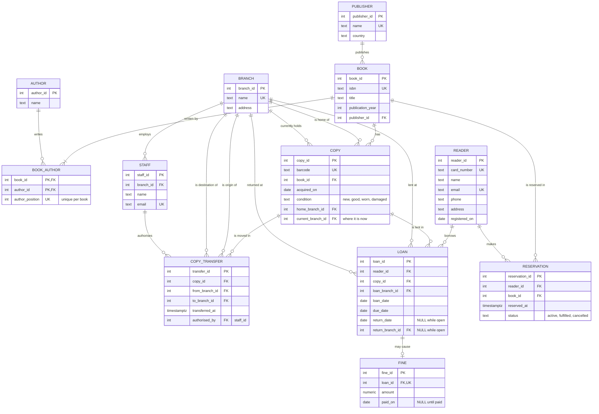

# Challenge 02: library with branches and copy transfers

Starting point: my model from `exercises/02-modelling/exercise/model.md`. The library now has three branches. Each copy has a home branch, can be transferred to another branch, and can be returned at any branch.

## 1. Extended ER diagram



## 2. New and changed tables

### New tables

| Table | Columns | Primary key | Foreign keys | UNIQUE / CHECK |
|---|---|---|---|---|
| `branch` | `branch_id`, `name`, `address` | `branch_id` | | `UNIQUE (name)` |
| `staff` | `staff_id`, `branch_id`, `name`, `email` | `staff_id` | `branch_id → branch` | `UNIQUE (email)` |
| `copy_transfer` | `transfer_id`, `copy_id`, `from_branch_id`, `to_branch_id`, `transferred_at`, `authorised_by` | `transfer_id` | `copy_id → copy`, `from_branch_id → branch`, `to_branch_id → branch`, `authorised_by → staff` | `CHECK (from_branch_id <> to_branch_id)`; all columns `NOT NULL` |

### Changed tables

| Table | Change | Why |
|---|---|---|
| `copy` | + `home_branch_id NOT NULL → branch` | The branch the copy belongs to |
| `copy` | + `current_branch_id NOT NULL → branch` | Where the copy is **now**, without reading the history (see below) |
| `loan` | + `loan_branch_id NOT NULL → branch` | Where the copy was lent |
| `loan` | + `return_branch_id → branch`, NULL while the loan is open; `CHECK ((return_date IS NULL) = (return_branch_id IS NULL))` | A copy can be returned at any branch, and that moves it |
| `book_author` | + `author_position`, `UNIQUE (book_id, author_position)` | Keeps the order of the authors (first, second, ...) |

### How every movement is kept

A copy changes branch in only two ways, and both are recorded and never deleted:
1. **A transfer**: a row in `copy_transfer` with from, to, date and the staff member who authorised it.
2. **A return at another branch**: the loan row already records `loan_branch_id` and `return_branch_id` with `return_date`.

So the full history of where a copy has been is `copy_transfer` + `loan` for that copy, ordered by date. While a loan is open (`return_date IS NULL`), the copy is with the reader.

### Current location without reading the history

`copy.current_branch_id` is a **deliberate denormalisation**: it can be derived from the history (the destination of the latest transfer or return), but storing it means "where is copy X now?" reads one row instead of scanning and sorting all the copy's movements. It's kept correct by updating it **in the same transaction** that inserts a `copy_transfer` row or closes a loan:

```sql
BEGIN;
INSERT INTO copy_transfer (copy_id, from_branch_id, to_branch_id, transferred_at, authorised_by)
VALUES (42, 1, 3, now(), 7);
UPDATE copy SET current_branch_id = 3 WHERE copy_id = 42 AND current_branch_id = 1;
COMMIT;
```

The `AND current_branch_id = 1` condition stops a transfer from a branch where the copy isn't. (The same could be done with a trigger on `copy_transfer` and on `loan`, so no application can forget it.)

## 3. Queries the model must answer

### "Where is copy X now?"

Tables: `copy` (current branch) + `branch` (its name) + `loan` (is it out with a reader?).

```sql
SELECT c.barcode, b.name AS branch,
       CASE WHEN l.loan_id IS NULL THEN 'on the shelf' ELSE 'on loan to reader ' || l.reader_id END AS status
FROM copy c
JOIN branch b     ON b.branch_id = c.current_branch_id
LEFT JOIN loan l  ON l.copy_id = c.copy_id AND l.return_date IS NULL
WHERE c.barcode = 'X';
```

One row read from `copy`, with no history scanned.

### "Which copies left branch Y last month?"

Tables: `copy_transfer` (transfers out of Y) + `loan` (copies lent at Y and returned at another branch) + `copy` (barcode).

```sql
SELECT c.barcode, t.to_branch_id AS went_to, t.transferred_at::date AS left_on, 'transfer' AS how
FROM copy_transfer t JOIN copy c ON c.copy_id = t.copy_id
WHERE t.from_branch_id = :y
  AND t.transferred_at >= date_trunc('month', now()) - interval '1 month'
  AND t.transferred_at <  date_trunc('month', now())
UNION ALL
SELECT c.barcode, l.return_branch_id, l.return_date, 'returned elsewhere'
FROM loan l JOIN copy c ON c.copy_id = l.copy_id
WHERE l.loan_branch_id = :y AND l.return_branch_id <> :y
  AND l.return_date >= date_trunc('month', now()) - interval '1 month'
  AND l.return_date <  date_trunc('month', now());
```

### Bonus: "Where was copy X on date D?"

The latest movement of the copy on or before D, from the union of `copy_transfer` (`to_branch_id`, `transferred_at`) and `loan` (`return_branch_id`, `return_date`). If there is none, it was at its `home_branch_id`. This is the history query, and it's only needed for questions about the past.

## 4. 3NF vs BCNF

**The difference.** A table is in **3NF** when, for every non-trivial functional dependency `X → A`, either `X` is a superkey **or `A` is part of some candidate key** (a "prime" attribute). **BCNF** removes that exception: every determinant `X` must be a superkey. So a table can be in 3NF but not in BCNF only when it has **several overlapping candidate keys** and an attribute of one key is determined by something that isn't a key.

**Example (not in my model).** Suppose each reader is assigned one librarian per branch, and each librarian works at only one branch:

`reader_librarian(reader_id, branch_id, librarian_id)`

- FDs: `{reader_id, branch_id} → librarian_id` and `librarian_id → branch_id`.
- Candidate keys: `{reader_id, branch_id}` and `{reader_id, librarian_id}`.
- It's in **3NF**: in `librarian_id → branch_id`, `librarian_id` isn't a key, but `branch_id` is prime (part of a key), so 3NF allows it.
- It's **not in BCNF**: `librarian_id` determines `branch_id` without being a superkey. The anomaly: if librarian 5 moves to another branch, that fact is repeated in every row of their readers and has to be updated in all of them. The BCNF decomposition is `librarian(librarian_id, branch_id)` + `reader_librarian(reader_id, librarian_id)`.

**My model: no table is in 3NF but not BCNF.** Functional dependencies of each table (every determinant is a candidate key):

| Table | Candidate keys | Non-trivial FDs | BCNF? |
|---|---|---|---|
| `branch` | `{branch_id}`, `{name}` | `branch_id → name, address`; `name → branch_id, address` | yes |
| `staff` | `{staff_id}`, `{email}` | `staff_id → *`; `email → *` | yes |
| `publisher` | `{publisher_id}`, `{name}` | `publisher_id → *`; `name → *` | yes |
| `author` | `{author_id}` | `author_id → name` | yes |
| `book` | `{book_id}`, `{isbn}` | `book_id → *`; `isbn → *` | yes |
| `book_author` | `{book_id, author_id}`, `{book_id, author_position}` | `{book_id, author_id} → author_position`; `{book_id, author_position} → author_id` | yes: the keys overlap (both contain `book_id`), but both determinants are keys |
| `copy` | `{copy_id}`, `{barcode}` | `copy_id → *`; `barcode → *` | yes |
| `copy_transfer` | `{transfer_id}` | `transfer_id → *` | yes |
| `reader` | `{reader_id}`, `{card_number}`, `{email}` | each key `→ *` | yes |
| `loan` | `{loan_id}` | `loan_id → *` | yes (see note) |
| `reservation` | `{reservation_id}` | `reservation_id → *` | yes |
| `fine` | `{fine_id}`, `{loan_id}` | `fine_id → *`; `loan_id → *` | yes |

`book_author` is the table to check carefully, because it's the one with overlapping candidate keys, which is exactly where 3NF and BCNF can differ. It's still BCNF because no attribute is determined by a non-key: knowing only the author doesn't tell you the position (an author is first on one book and second on another), and knowing only the position doesn't tell you the author.

Note on `loan`: `due_date` is stored even though it is `loan_date + 14` under today's rule (my denormalisation in exercise 02). It doesn't create an FD `loan_date → due_date`, because the rule can change, and old loans keep the due date they were given. So two loans with the same `loan_date` can have different `due_date`s. The same goes for `copy.current_branch_id`: it's a stored copy of the history, but in the table itself it depends only on `copy_id`.
