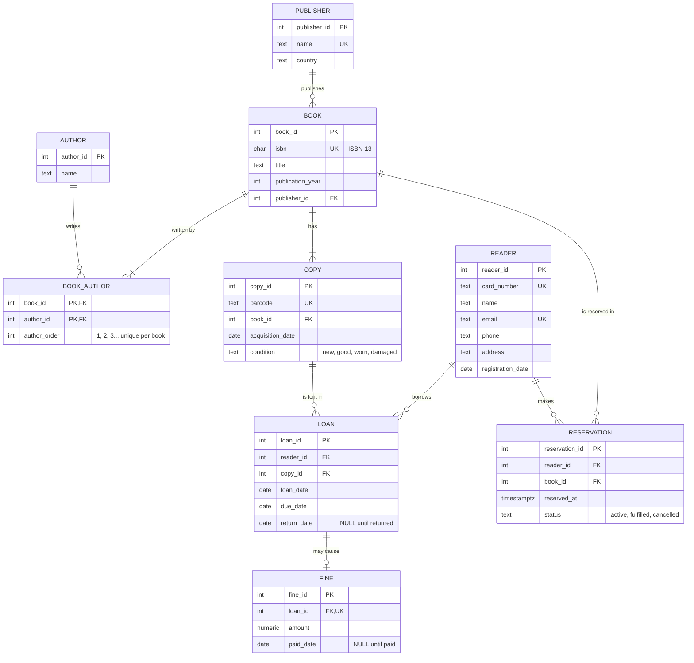

# Municipal library model

## 1. ER diagram

Cardinalities:

- A publisher publishes many books; a book has exactly one publisher.
- A book has one or more authors and an author writes many books, through `BOOK_AUTHOR`, which keeps the order of the authors (`author_order`).
- A book has one or more copies; a copy is of exactly one book.
- A reader has many loans and a copy is lent in many loans over time; each loan is one reader and one copy.
- A reader makes many reservations, and a book has many reservations; a reservation is for a book, not a copy.
- A loan causes at most one fine (zero or one); a fine belongs to exactly one loan.

## 2. Tables (3NF)

| Table | Columns | Primary key | Foreign keys | UNIQUE |
|---|---|---|---|---|
| `publisher` | `publisher_id`, `name`, `country` | `publisher_id` | | `name` |
| `author` | `author_id`, `name` | `author_id` | | |
| `book` | `book_id`, `isbn`, `title`, `publication_year`, `publisher_id` | `book_id` | `publisher_id → publisher` | `isbn` |
| `book_author` | `book_id`, `author_id`, `author_order` | `(book_id, author_id)` | `book_id → book`, `author_id → author` | `(book_id, author_order)` |
| `copy` | `copy_id`, `barcode`, `book_id`, `acquisition_date`, `condition` | `copy_id` | `book_id → book` | `barcode` |
| `reader` | `reader_id`, `card_number`, `name`, `email`, `phone`, `address`, `registration_date` | `reader_id` | | `card_number`, `email` |
| `loan` | `loan_id`, `reader_id`, `copy_id`, `loan_date`, `due_date`, `return_date` | `loan_id` | `reader_id → reader`, `copy_id → copy` | |
| `reservation` | `reservation_id`, `reader_id`, `book_id`, `reserved_at`, `status` | `reservation_id` | `reader_id → reader`, `book_id → book` | |
| `fine` | `fine_id`, `loan_id`, `amount`, `paid_date` | `fine_id` | `loan_id → loan` | `loan_id` |

`book_author` is the association table of the N:N relationship between books and authors. `UNIQUE (book_id, author_order)` means each position (first author, second author...) is used once per book.

`UNIQUE (loan_id)` in `fine` makes the relationship one-to-zero-or-one: a loan can't have two fines.

## 3. Business rules a table structure alone cannot enforce

| Rule | Where | How |
|---|---|---|
| `condition` is `new`, `good`, `worn` or `damaged` | Constraint | `CHECK (condition IN ('new', 'good', 'worn', 'damaged'))` |
| `status` is `active`, `fulfilled` or `cancelled` | Constraint | `CHECK (status IN ('active', 'fulfilled', 'cancelled'))` |
| The ISBN is a valid ISBN-13 | Constraint | `CHECK` (or a domain) on the format and the check digit |
| The due date is 14 days after the loan date | Constraint | `CHECK (due_date = loan_date + 14)` |
| The return date is not before the loan date | Constraint | `CHECK (return_date IS NULL OR return_date >= loan_date)` |
| A copy can be in at most one open loan at a time | Constraint | Partial unique index: `CREATE UNIQUE INDEX ON loan (copy_id) WHERE return_date IS NULL` |
| A reader can have at most 5 open loans | Trigger | `BEFORE INSERT` on `loan`: count the reader's loans with `return_date IS NULL` and raise an error if there are already 5. A `CHECK` can only see one row, so it can't count the other loans. Two loans for the same reader arriving at the same time could both see 4, so the trigger first locks the reader row (`SELECT ... FROM reader WHERE reader_id = NEW.reader_id FOR UPDATE`). |
| A reader can only reserve a book when no copy of it is available | Trigger | `BEFORE INSERT` on `reservation`: raise an error if a copy of the book has no open loan. |
| A reader has at most one active reservation for the same book | Constraint | Partial unique index: `CREATE UNIQUE INDEX ON reservation (book_id, reader_id) WHERE status = 'active'` |
| Reservations for the same book are served in the order they were made | Application | When a copy is returned, the application gives it to the `active` reservation with the oldest `reserved_at` (`ORDER BY reserved_at LIMIT 1 FOR UPDATE`) and sets it to `fulfilled`. The table only stores the order; serving it is a process. |
| A late return creates a fine of 0.50 per day late | Trigger | `AFTER UPDATE OF return_date` on `loan`: if `return_date > due_date`, insert a fine with `amount = 0.50 * (return_date - due_date)`. In the database, the fine can't be forgotten whichever application records the return. |
| A fine's amount is positive | Constraint | `CHECK (amount > 0)` |

## 4. Denormalisation

I store `due_date` in `loan` even though it can be calculated (`loan_date + 14`).

Reason: if the loan period changes later (for example to 21 days), old loans must keep the due date they were given, and their fines must still be calculated from it. With today's rule, `due_date` depends on `loan_date`, so storing it is a small denormalisation. The `CHECK` of task 3 keeps the two consistent while the rule is 14 days. If the rule changes, that `CHECK` is changed for new loans only (for example `CHECK (loan_date < '2027-01-01' OR due_date = loan_date + 21)`).
