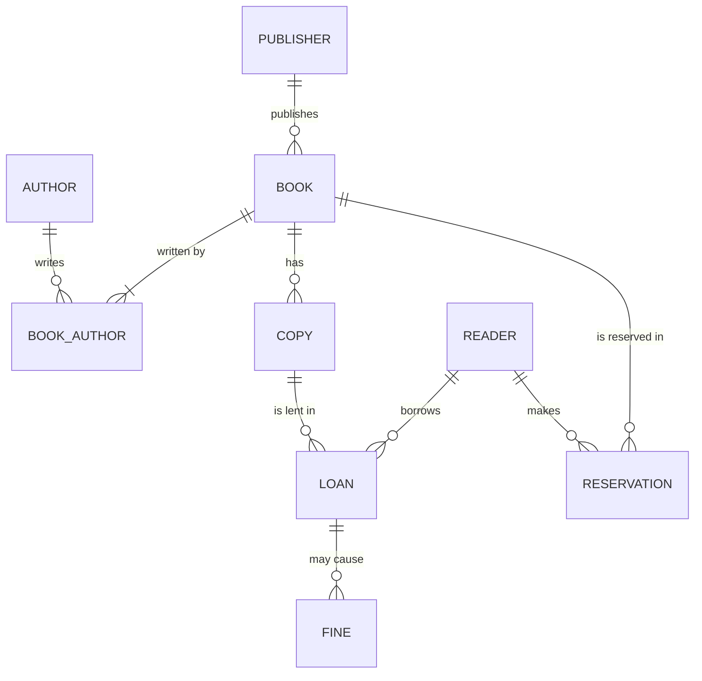

# Municipal library model

## 1. ER diagram

## 2. Tables (3NF)

| Table | Primary key | Foreign keys |
|---|---|---|
| publisher(name) | publisher_id | |
| author(name) | author_id | |
| book(isbn, title) | book_id | publisher_id |
| book_author | (book_id, author_id) | book_id, author_id |
| copy(barcode) | copy_id | book_id |
| reader(name, email) | reader_id | |
| loan(loan_date, due_date, return_date) | loan_id | copy_id, reader_id |
| reservation(reserved_at) | reservation_id | book_id, reader_id |
| fine(amount, paid) | fine_id | loan_id |

## 3. Denormalisation

I store due_date in loan even though it can be calculated.
Reason: if the loan period changes later, old loans keep their original due date.